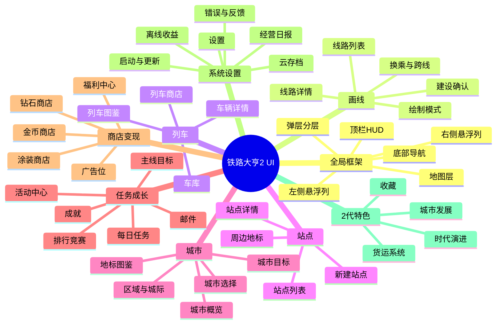
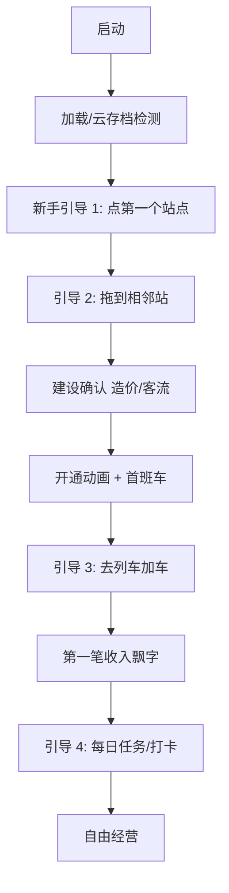
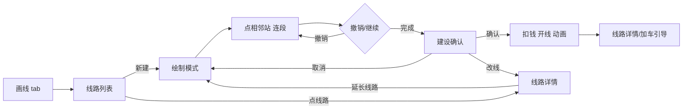
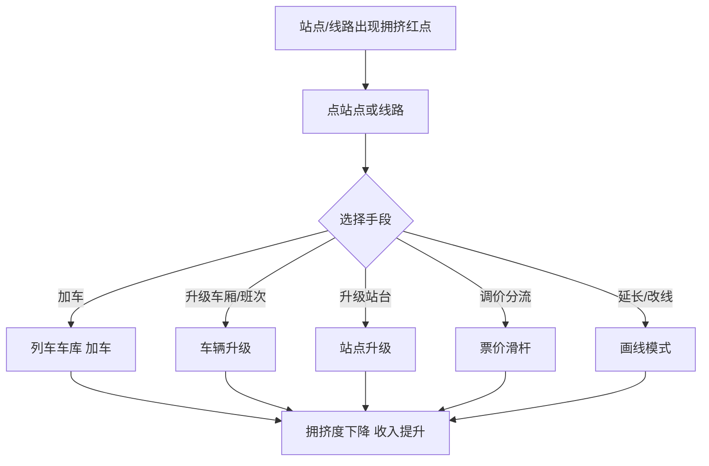
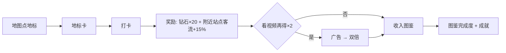
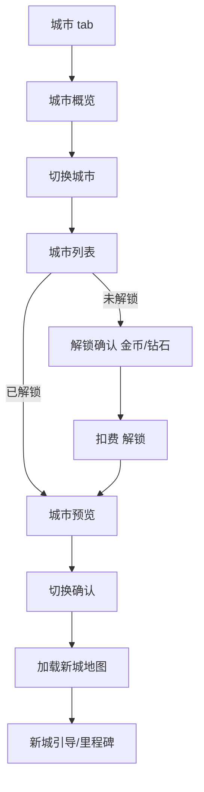
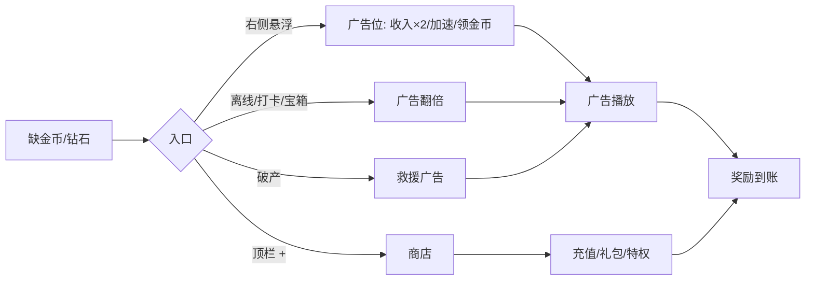

# 《铁路大亨2》界面信息架构 · 思维导图设计稿 v0.1

> 状态：**设计稿（只出逻辑，不落地代码）**  
> 参考：TapTap《地铁线路模拟器》141 秒竖屏实机录屏（E:/aigc/Railway2_unity/video/20261110-111142.mp4）  
> 前作：《铁路大亨：从家乡走向世界》v1.8.0（E:/aigc/global-rail-tycoon-maker）  
> 新作定位：**竖屏 · 手绘城市地图 · 单指画线 · 轻量铁路经营 + 城市图鉴**

---

## 0. 怎么读这份稿

- 第 2 节是**总思维导图**（一屏看全貌）。
- 第 3 节是**界面树**（页面层级 / 入口路径）。
- 第 4-5 节把每个节点拆成「目标 / 入口 / 布局 / 控件 / 状态 / 交互 / 出口」。
- 第 6 节是**核心操作流程**（开线、延长、加车、打卡、切城、变现、离线）。
- 第 9 节是**字段字典**（HUD 和面板上的每个数字是什么）。
- 第 11 节是**需要你拍板的问题**（带推荐选项）。
- 第 12 节是**参考视频时间轴**（设计依据，方便你回看原片）。

设计原则：**地图就是主界面**。所有经营操作都从地图上点站点 / 点线路 / 点地标进入，面板只做「看数据 + 做决定」，不让玩家在多层菜单里找功能。

---

## 1. 设计基准

| 项目      | 设计结论                                                |
| ------- | --------------------------------------------------- |
| 平台 / 方向 | TapTap Maker，**竖屏 9:16 锁定**，设计基准 1080×1920，按安全区自适应  |
| 输入      | 单指点击 / 拖拽 / 拖线；双指缩放；无 hover、无右键                     |
| 镜头      | 2D 俯视手绘地图，可平移 + 缩放（0.6×–2.5×），开局自动框住首个站点            |
| 节奏      | 1–3 分钟一个小循环：收收益 → 处理拥挤 → 画线/延长 → 升级 → 领任务 → 打卡 → 切城 |
| 收益模型    | **实时 /分钟收益**（顶栏直接显示）+ 离线收益（回来一次性领取）                 |
| 美术      | 手绘绘本，日系清新                                           |
| 音频      | 轻快 BGM + 点击/开线/升级音效 + 车站环境音；震动可关                    |
| 变现      | 广告（收入×2、加速、领金币、宝箱、打卡×2、破产救援）                        |
| 存档      | 本地自动存档 + 手动云存档；单机为主，排行榜走云变量                         |

### 1.1 从参考里「借」什么

> 逐秒拆解、15 个界面与 11 条流程见 [video-ui-inventory.md](../reference/video-ui-inventory.md)（600 行，17 张裁剪图）。

**四层结构**（地图常驻 HUD → 底部抽屉 → 全屏二级页 → 压暗浮层）、四个底部 tab（画线/列车/站点/城市）、左右各 3 个悬浮列、开线确认气泡（可改线）、线路详情（票价滑杆 / 加车 / 延长 / 升级 / 拆除）、列车车库三件套升级（车速 / 车厢 / 班次）、城市切换（3 星 + 通关/金币解锁）、每日任务 + 成就 + 活跃度宝箱、地标打卡（全屏庆祝页）、时间窗撤销（10 秒倒数）、广告原位替换、身份色系统（tab 色 + 线路色跨页统一）。

### 1.2 必须「改」成铁路大亨的地方

| 参考（地铁） | 铁路大亨 2 |
|---|---|
| 地铁线路，站距短 | 铁路线：站距更长，可跨江/跨山，造价随地形变化 |
| 只有客运 | 客运为主 + 后期货运（货场 / 货运车厢 / 运输合同） |
| 固定现代车型 | 时代演进：蒸汽 → 内燃 → 电力 → 高铁，车型即收藏 |
| 城市静态 | 线路带动城市地块成长（荒地→住宅→商业），城市面板看繁荣度 |
| 单城经营 | 后期解锁城际干线，地图拉远到区域网 |
| 现代扁平 UI | 手绘绘本 UI（与前作 v4 视觉彻底区分） |

### 1.3 与前作 1 代的关系

- **继承**：城市/车站数据思路、226 款机车资产（首版只用 15–30 款）、收藏/编年史框架、云存档、广告接入经验、数值平衡经验。
- **重做**：交互（地图直接画线，替代「线路规划器 + 列表」）、布局（单城竖屏，替代全球大地图）、视觉（手绘）、结算（实时收益 + 离线收益）。
- **不继承**：v1.8 存档（结构差异太大，做迁移成本高、收益低），只做「老玩家礼包」。

### 1.4 前作资产继承 / 重做清单（摘要）

> 详细证据与文件路径见 [legacy-ui-inventory.md](../reference/legacy-ui-inventory.md)（536 行，标了 A/B/C 证据强度）。

**直接继承（框架级，几乎不改）**

- HUD 两行骨架（控制行 + 数据行）与安全区钳制。
- 弹层规范：90% 宽 / 60% 高内滚 / sm-md-lg-fullscreen / sheet。
- 通告条 ticker：所有动作结果写同一条通告，替代零散 Toast。
- 日结单收据版式、离线收益弹层。
- **广告奖励分层架构**：AdService 适配层 + 统一发奖层（前置条件 / 频控 / 幂等 / 失败降级 / 长视频 180s / 观看期间暂停时钟 / 奖励只在 game 层发放）。
- 三档存档 + `.bak`/`.next` 写流程 + 云备份抽象。
- 新手引导「弹窗 ≠ 指引」双状态 + 顶部目标条接下一个目标。
- 收藏三件套 + 「收藏不加数值」原则（地标打卡即纪念章）。
- 地图性能：视口惰性建标（≤64/帧）+ 整键缓存 + 手势自愈。
- 字体 5 族分工 + autoFitText + 正负金额语义色。

**必须重做（语义先定，再动手）**

- 地图渲染：经纬度全网拓扑 → 单城手绘插画。
- 开线交互：下拉选站表单 → 图上拖拽成线。
- 导航：19 地区 / 大洲 → 城市切换。
- 运力口径：客货双运力 / 里程 → 班次 / 车厢 / 载客 / 单程时长。
- 顶栏字段：接入城市 / 运营日 → 城市进度 / 星级。
- 主色盘：站台绿 → 线路色盘作为一等 token，操作色改中性深色。

**首版明确不做**（前作内容债教训）：226 款机车图鉴、23 章编年史、排行榜、每日挑战、铁路经理、破产系统、多地区解锁。

**方法论**：真值由脚本生成（NUMBERS 类）、发版即重截且截图文件名带版本、每条关键决策记录「被否决选项 + 复审条件」。

---

## 2. 总思维导图



---

> 上图为二级总览（9 条主线 + 45 个功能组）；三级细节见第 5 节，或打开 [交互版思维导图](ui-ia-mindmap.html) 逐层展开、搜索、看节点说明。

## 3. 界面树（页面 / 入口 / 层级）

```text
启动
└─ P01 启动与加载
   ├─ 版本公告 / 更新说明
   ├─ 云存档恢复（本地 / 云端）
   └─ P02 城市地图（主界面）
      ├─ 顶栏
      │  ├─ 金币 → P19 商店（金币 tab）
      │  ├─ 钻石 → P19 商店（钻石 tab）
      │  ├─ 城市名 → P12 城市概览
      │  └─ 设置 → P20 设置 → P21 存档/云存档
      ├─ 左侧悬浮列（默认 3 个）
      │  ├─ 任务 → P15 任务
      │  ├─ 图鉴 → P16 图鉴
      │  ├─ 排行 → P17 排行/竞赛
      │  └─ 活动（限时出现）→ P18 活动/福利
      ├─ 右侧悬浮列（3 个广告位）
      │  ├─ 收入×2 / 加速 / 领金币 → 广告位 O06
      │  └─ 日报 → P12 城市概览 → P22 经营日报
      ├─ 底部导航
      │  ├─ 画线 → P03 线路列表 → P04 绘制模式 → P06 建设确认
      │  │           └─ 点已有线路 → P05 线路详情
      │  ├─ 列车 → P07 车库 → P08 车辆详情
      │  │           ├─ P09 列车商店
      │  │           └─ P16 图鉴（列车）
      │  ├─ 站点 → P10 站点列表 → P11 站点详情
      │  │           └─ 地标 → P14 地标图鉴（打卡）
      │  └─ 城市 → P12 城市概览
      │              ├─ P13 城市选择/解锁
      │              └─ P14 地标图鉴
      ├─ 地图直接交互
      │  ├─ 点站点 → P11 站点详情
      │  ├─ 点线路 → P05 线路详情
      │  ├─ 点地标 → P14 地标卡（打卡）
      │  ├─ 点事件气泡 → O04 随机事件
      │  └─ 点金币飘字 / 车站 → 对应详情
      └─ 启动/回访弹层
         ├─ P23 离线收益
         ├─ P24 邮件
         └─ O01 通用确认 / O02 奖励 / O03 解锁 / O05 打卡
```

---

## 4. 全局框架

### 4.1 顶栏 HUD

- **左：金币胶囊**——金币图标 + 数值（数字滚动） + 第二行小字「收入 474/分钟」。点击 → P19 商店金币页。
- **中：城市牌**——城市名（大号手写体） + 下拉箭头；下方「城市进度 16%」+ 细进度条。点击 → P12 城市概览。
- **右：钻石 + 加号 + 齿轮**——钻石图标 + 数值 + 绿色「+」（→ P19 钻石页）；最右设置齿轮（→ P20）。三段等宽、左右对称，城市名视觉层级最高；所有数字等宽 + 滚动动画。
- 红点：任务 / 图鉴 / 排行 / 活动 / 邮件，允许同时出现，按优先级排队（任务 > 活动 > 图鉴 > 排行）。
- 顶栏常驻，任何底部抽屉打开时**保留**（参考实现如此），全屏页（商店/城市选择/任务）时隐藏。

### 4.2 左侧悬浮列（默认 3 个，活动期临时 +1）

- 常驻：任务（红点）、图鉴、排行。每个 56×56 手绘图标 + 下方 11pt 标签，垂直居中偏上；带红点/数字角标。
- 限时活动开启时，第 4 个「活动」图标（带倒计时角标）才出现，活动结束自动收起——平时不占位置。
- 点击打开对应全屏页；绘制模式下整列淡出，避免误触。

### 4.3 右侧悬浮列（3 个广告位）

- 收入×2 / 加速 / 领金币，固定 3 个，每个右上角统一「蓝胶片 + 白播放三角」广告角标。
- 广告**永不弹窗**：只在这里竖排，以及在金币不足时把按钮**原位替换**为「看视频免单 / 看视频抵扣」。
- 经营日报不占右列：入口放到 P12 城市概览的数据区（P22），避免变现入口过密。

### 4.4 底部导航（4 tab，身份色固定）

画线（黄）/ 列车（蓝）/ 站点（绿）/ 城市（米），四等分；**身份色永久不变**，选中只加「托盘」+ 图标放大，不做整块反色，避免和线路色打架。

- 默认进入「画线」tab（参考行为）；点 tab 打开默认面板（画线/站点 = 底部抽屉；列车/城市 = 全屏二级页），再点一次关闭。
- 「列车」tab 在有线路拥挤 ≥ 90% 时显示红点。
- 打开抽屉时地图整体下沉 + 轻微压暗；抽屉高度约屏高 45%–62%，可下拉关闭。
- **线路身份色跨页面统一**：线路圆标、车库 tab、操作卡主色、地图线色全一致（1 红 / 2 绿 / 3 蓝 / 4 橙 / 5 紫…）。

### 4.5 地图层

- **站点节点**：圆形彩色站点 + 站名标签；换乘站为双环；拥挤站有红色脉冲环；地标站有星标。
- **线路**：粗描边彩色线，选中时描边高亮；线路上有 Q 版列车来回跑（速度=线路等级）。
- **地标**：手绘插画（镇海楼、西湖公园、烟台山…）+ 名称，可点击打卡。
- **事件气泡**：随机事件（天气、节日、故障、检查）出现 30 秒，点击进事件弹窗。
- **飘字**：金币 +N、客流 +N、升级成功，向上飘散。
- **助手**：左下角女乘务员 + 猫，按状态给一句提示（拥挤、可升级、新地标、任务完成）。
- 手势：单指拖动平移、双指缩放、双击放大一级；点击空白关闭面板；平移/缩放不做惯性（移动端更稳）。

### 4.6 弹层分层（从下到上）

1. 地图层  
2. 底部抽屉（画线/站点，可下拉关闭）  
3. 居中弹窗（建设确认、拆除确认、购买确认、随机事件/宝箱）  
4. 全屏页（列车车库/城市/任务/图鉴/排行/活动/商店/设置）  
5. Toast / 飘字 / 引导手指  
6. 庆祝层（开线礼花、升级、获得奖励，可点击跳过）

---

## 5. 逐页功能逻辑

> 每页固定七段：目标 / 入口 / 布局 / 控件 / 状态 / 交互 / 出口。数值只是设计默认值，可调。

### P01 启动与加载

- **目标**：3 秒内让玩家看到城市地图；处理首次资源下载与云存档。
- **入口**：游戏启动。
- **布局**：Logo + 手绘进度条 + 一句随机小贴士；底部版本号。
- **控件**：进度条、贴士、版本号、跳过。
- **状态**：首次加载（资源下载 %）/ 热启动（0.5 秒）/ 更新公告（有新版时）/ 云存档恢复（检测到云端较新）。
- **交互**：加载完成 → 淡入地图；有更新 → 公告弹窗（今日不再提示）；云存档冲突 → 二选一（本地 / 云端，显示时间与等级）。
- **出口**：P02 主界面；或 O10 资源失败重试。

### P02 城市地图（主界面）

- **目标**：所有操作的起点与回程点；一眼看懂「哪条线挤了、哪里能赚钱、哪里能升级」。
- **入口**：启动完成、任何页面返回。
- **布局**：顶栏 + 地图 + 左右悬浮列 + 底部导航；助手在左下。
- **控件**：见 4.1–4.5。
- **状态**：默认 / 绘制模式（顶栏保留、悬浮列淡出、地图站点脉冲）/ 面板打开（地图下沉压暗）/ 教学蒙层 / 事件弹窗。
- **交互**：点站点→P11；点线路→P05；点地标→P14 图鉴/打卡（首次覆盖自动弹 O05）；点事件→O04；点空白→关面板；拖拽/缩放；触发新手引导。
- **出口**：所有页面。

### P03 画线 · 线路列表（底部抽屉）

- **目标**：管理已有线路、进入新建线路。
- **入口**：底栏「画线」tab。
- **布局**：标题「画线」+ 副标题「已建 4/6 条线（照着现实线路还原）」；线路行列表；底部新建按钮 + 操作说明。
- **控件**：
  - 行：色块编号（1/2/4…）、线路名、状态行「8 站 · 收入 120/分 / 现实 25 站，连了 4 站」、右侧「指引」按钮（打开该线在现实中的走向提示）。
  - 未解锁线路：灰色 + 锁 + 解锁条件（城市等级 / 里程碑）。
  - 底部：「+ 新建线路」主按钮；说明文案（拖站画线 / 两头拖是延长 / 同站两条线=换乘 客流×1.8 / 管理里可调价、加车、拆除）。
- **状态**：空（首条线引导高亮）/ 有线路 / 有未解锁 / 达线路上限（按钮变「升级城市解锁」）。
- **交互**：点行 → 相机聚焦该线 + 打开 P05；点指引 → 地图高亮现实站点建议；点新建 → P04。
- **出口**：P04 / P05 / 关闭。

### P04 画线 · 绘制模式

- **目标**：低门槛画出第一条线，且随时能反悔。
- **入口**：P03 新建；P05「延长线路」；地图长按空白（快捷）。
- **布局**：地图放大到可点精度；顶部浮条「开通 X 号线」；底部右侧「撤销 N」「完成」「取消」。
- **控件**：站点高亮、路径预览线、造价气泡（¥78）、预计客流（+26/分）、撤销、完成、取消。
- **规则**：
  - 从起点站开始，只能连**相邻站点**（道路/轨道连通图），不能跳站。
  - 单条线最少 2 站；站数上限随城市等级提升（初始 6 站）。
  - 同一站不能在一条线里重复；两条线共用站 → 自动成为换乘站（客流 ×1.8）。
  - 跨江/跨山/穿城段落有造价加成，预览时显示。
  - **撤销 = 时间窗撤销**（参考实测）：每次落段后右下角出现「撤销 N」圆钮，从 10 倒数到 1；点它回退这一步，超时消失。不做常驻撤销栈，降低误触。
- **状态**：未起笔 / 绘制中 / 可完成 / 达上限 / 余额不足（完成按钮变「去赚钱」）。
- **交互**：点站→连一段；再点相邻站→继续；点已完成段→？；撤销→回退一段；完成→P06；取消→回滚全部。
- **出口**：P06 / 放弃回 P03。

### P05 线路详情（底部抽屉）

- **目标**：一条线的全部经营决策都在这里完成。
- **入口**：点地图线路；P03 点行；开线完成后自动打开。
- **布局**（参考实测结构）：
  - 头部：线路色块 + 编号 + 名称 + 「X 站 · Y 个换乘站」；右侧助手气泡（状态提示）；关闭 X；下拉把手。
  - 三宫格：客流 49/分 · 运力 82%（**≥90% 时红字 + 助手台词「站点都挤红了，快去加车吧」**）· 收入 120/分。
  - 站点序列条：起点站 —— 终点站，中间显示「指引」/「开辟跨线」按钮。
  - 票价行：− 滑杆 + 和 ¥3 大字；说明「2 到 8 元 · 票价越高收入越高，客流越少」。
  - 列车行：列车 1/8 + 车厢小图标 + 「+ 加车 289」按钮。
  - 底部三按钮：延长线路（橙）/ 线路升级（绿）/ 拆除（红）。
- **控件/状态**：票价滑杆（实时预览收入与客流变化）/ 加车（金币不足置灰）/ 延长（进入 P04）/ 升级（弹升级确认）/ 拆除（O01 危险确认，说明退回金额）/ 更多菜单（改名、换色、跨线车、复制线路）。
- **交互**：拖动滑杆 → 三宫格数值实时变化；加车 → 扣钱 + 车辆飞入动画；延长 → 地图进入绘制模式；拆除 → 二次确认。
- **出口**：P04 / 升级弹窗 / O01 / 关闭。

### P06 建设确认（浮层气泡）

- **目标**：开线前把「花多少、赚多少、还能怎么改」讲清楚。
- **入口**：P04 完成；延长完成。
- **布局**：小气泡贴在地图空白处（参考位置在右侧中部），不遮挡线路。
- **控件**：标题「延长 1 号线」/「开通 2 号线」；预计客流 +26/分钟；造价 ¥78；「确认建设」绿色主按钮；「取消」；两条快捷改法：「改成延长 2 号线」「改成另开新线」。
- **状态**：可建 / 余额不足（按钮变「金币不足，去赚钱」并给广告入口）/ 预计亏损（黄色警告：预计客流低于维护成本）。
- **交互**：确认 → 扣钱 + 开线动画 + 首班车驶出 + 引导加车；取消 → 回到绘制；改线 → 直接切换目标线路。
- **出口**：P05 / P03 / 地图。

### P07 列车 · 车库（全屏二级页）

- **目标**：按线路管理车辆与运力，解决拥挤。
- **入口**：底栏「列车」tab；P05 加车。
- **布局**：**全屏页**，左上返回；标题「列车车库」+ 线路 tab（1/2/4/5 号线，tab 用线路身份色，可横滑）；当前线路摘要（班次 / 运力 / 拥挤度）；三档升级卡（车速 / 车厢 / 班次）；底部「+ 加车 289」。
- **广告位**：升级价格旁统一广告角标；金币不足时按钮原位变「🎬 看视频立减」，不弹窗。
- **控件**：
  - 车辆卡片：车型缩略图（侧视）、名称、年代徽章；三行升级项「车速 Lv.0 → +0% ¥136」「车厢 Lv.0 → 每列载客 40→60 ¥204」「班次 Lv.0 → 在线列车 1→2 列 ¥289」；每行右侧升级按钮。
  - 线路摘要：本线列车数 / 上限、拥挤度条。
  - 底部：加车（金币，价格随数量递增）、「一键升级」（P2）。
- **状态**：空线路（引导加车）/ 正常 / 满编（加车置灰）/ 拥挤（红色提示 + 助手建议）。
- **交互**：切换线路 tab → 相机聚焦该线；点卡片 → P08；点升级 → 扣钱 + 数值动画 + 可能触发成就；加车 → 车辆入库动画。
- **出口**：P08 / P09 / 关闭。

### P08 车辆详情 / 升级（抽屉或全屏）

- **目标**：单辆机车的深度养成与调配。
- **入口**：P07 点卡片。
- **布局**：大图机车立绘 + 名称/型号/年代；属性四宫格（速度 / 载客 / 维护费 / 舒适度）；升级列表；编组；涂装；调配；退役。
- **控件**：
  - 属性条：当前值 + 下一级预览（箭头 + 绿色增量）。
  - 升级项：车速 / 车厢 / 班次（与车库一致），等级上限受时代限制。
  - 编组：车厢数 − 数字 +（影响载客与维护费）。
  - 涂装：当前涂装缩略图 + 「更换」→ P09。
  - 调配：下拉选择其他线路（空位足够时）。
  - 退役：确认后返还部分金币，车辆进图鉴（已收集不消失）。
- **状态**：锁定（未解锁车型，显示解锁条件）/ 已拥有 / 使用中 / 满级 / 金币不足。
- **交互**：升级 → 数值滚动 + 成就进度；调配 → 车辆飞行动画；退役 → O01。
- **出口**：P07 / P09 / 关闭。

### P09 列车商店 / 涂装（全屏）

- **目标**：钻石消耗点，卖车型、涂装、特权。
- **入口**：P07「商店」；P08 更换涂装；钻石不足时的引导。
- **布局**：顶部钻石余额；tab「列车 / 涂装 / 钻石特权 / 换金币」；卡片网格（大图 + 名称 + 价格 + 状态）；底部说明。
- **控件**：
  - 卡片状态：未拥有（价格）/ 使用中 / 已拥有 / 锁定（时代/城市等级）。
  - 购买确认：O01 二次确认，余额不足 → 「去获取钻石」。
  - 钻石特权：线路数上限 +1、离线收益时长 +、每日免费加速、自动收租等（参考「钻石特权」按线路卖，这里建议改成账号级特权，更好卖）。
- **状态**：可购买 / 余额不足 / 已售罄（限时）。
- **交互**：点卡片 → 大图预览（左右滑）→ 购买/使用；购买成功 → O02 奖励弹窗。
- **出口**：P07 / P08 / P19。

### P10 站点 · 列表（底部抽屉）

> 参考录屏里底栏「站点」tab 全程没有打开——这是唯一没有参考样本的面板，以下按线路详情抽屉的范式自研（分区 KPI + 升级行 + 底部按钮）。

- **目标**：从「线」的视角切到「站」的视角，找拥挤站、找可升级站。
- **入口**：底栏「站点」tab。
- **布局**：筛选 chips（全部 / 换乘 / 拥挤 / 地标 / 可升级）；排序（客流 / 收入 / 等级）；站点行列表。
- **控件**：行 = 站点图标 + 站名 + 所属线路色点 + 客流/分 + 拥挤度条 + 等级 + 「升级」箭头；点击行 → 相机飞过去并打开 P11。
- **状态**：空（新城市未建站）/ 正常 / 有红点（可升级/拥挤）。
- **交互**：筛选切换、排序切换、点行聚焦。
- **出口**：P11 / P14 / 关闭。

### P11 站点 · 详情 / 升级（底部抽屉）

- **目标**：解决拥挤、提升单站收益、完成打卡。
- **入口**：点地图站点；P10 点行；助手提示。
- **布局**：
  - 头部：站名（可改名）+ 等级徽章 + 换乘线路徽章 + 收藏星。
  - 三宫格：客流/分 · 拥挤度 % · 收入/分。
  - 设施升级列表：站台容量 / 出入口 / 换乘通道（仅换乘站）/ 商业设施（便利店、广告灯箱）；每项 = 等级 + 效果 + 价格 + 升级按钮。
  - 周边地标：1–3 个地标 chip + 打卡状态 + 「去看看」。
  - 底部：一键升级（P2）、改名、收藏。
- **状态**：普通站 / 换乘站 / 地标站 / 拥挤（红色）/ 满级 / 金币不足。
- **交互**：升级 → 扣钱 + 站台长高动画 + 客流提升飘字；改名 → 文本输入（免费 1 次，之后花钻石）；打卡 → P14。
- **出口**：P14 / 关闭。

### P12 城市 · 概览（底部抽屉或全屏）

- **目标**：一屏回答「这座城经营得怎么样、下一步做什么」。
- **入口**：顶栏城市名；底栏「城市」tab；P13 切换后。
- **布局**：
  - 头部：城市名 + 城市等级 + 繁荣度进度条 + **星级（0–3 星）**。
  - 数据网格：线路数、车站数、总里程、日均客流、收入/分、维护费/分。
  - 城市目标（里程碑列表 3–5 条，当前高亮 + 奖励）。
  - 地标图鉴入口（n/总数 + 完成度环）。
  - 城市故事 / 城市排行（P1）。
  - 底部：切换城市（主按钮）。
- **状态**：新城（引导开第一条线）/ 成长中 / 满级 / 有可领奖励（红点）。
- **交互**：点里程碑 → 展开要求与奖励；点地标 → P14；点切换 → P13。
- **出口**：P13 / P14 / 关闭。

### P13 城市 · 选择 / 解锁（全屏）

- **目标**：城市收集与长期目标，钻石/金币消耗点。
- **入口**：P12 切换城市；城市升级提示。
- **布局**：顶部标题「选择城市」+ 副标题「一条铁路 · 连接更美好的城市」；城市卡片竖列表；页脚「更多精彩的城市，正在途中…」。
- **控件/行**：左=城市线网缩略图；中上=城市名 + **3 颗星（x/3）**；中下=状态行（已建成线路 4 条 · 车站 23 座 / 暂未建设，期待与你相遇！）；右侧按钮：当前城市（绿实心 + 下方「收入 474/分」）/ 未解锁（🔒 通关前一城市解锁，或 🪙 2M 解锁）/ 已解锁切换。
- **状态**：当前城市 / 已解锁 / 未解锁（通关条件或 K/M/B 金币价）/ 加载切换中。
- **数值规范**：大数字统一 K / M / B 缩写（2M、80M、2B）。
- **交互**：点城市 → 城市预览卡（地图缩略图 + 特色地标 + 推荐线路）→ 切换/解锁确认 → 加载动画 → 回到 P02。
- **出口**：P02 / P12。

### P14 地标图鉴 / 打卡（全屏或抽屉）

- **目标**：把「城市漫步」做成收集玩法，给地图探索一个理由。
- **入口**：① 线路/站点首次覆盖地标时**自动弹出**全屏庆祝页（O05，参考行为）；② 地图点地标卡；③ P11 周边地标；④ P12 / P16 图鉴。
- **打卡页（O05）**：顶部缎带写触发动作（「延长 1 号线！」）→ 主标题「新地标解锁！」→ 宝丽来相片（地标插画 + 相机纸边 + 「打卡成功」红印章）→ 奖励两条（附近站点客流 +15% / 钻石 ×20）→ [收下] / [🎬 看视频 再领 ×20]。
- **布局**：
  - 顶部：城市名 + 完成度（n/总数 + 进度环）。
  - 网格：地标卡（插画 + 名称 + 打卡状态 + 加成标签）。
  - 点卡 → 详情弹层：大图 + 简介 + 打卡按钮 + 奖励（钻石 ×20 + 附近站点客流 +15%）+ 「看视频再得 ×2」。
- **状态**：未打卡 / 已打卡 / 可打卡（在当前城市）/ 未到访（灰色：先去该城市）。
- **交互**：打卡 → 动效 + O02 奖励 + 图鉴点亮；集齐一组 → 额外奖励 + 成就。
- **出口**：P02 / P12。

### P15 任务 · 每日 / 成就（全屏）

- **目标**：给每日一个「回来玩」的理由，给长期一个「继续玩」的理由。
- **入口**：左侧「任务」；任务完成 toast。
- **布局**：
  - 顶部助手插画 + 一句鼓励语；tab「每日任务 / 成就」。
  - 每日：活跃度进度条 + 3 个宝箱节点（20/70/100）；任务行（图标 + 标题 + 进度条 + 奖励 + 按钮）；刷新倒计时。
  - 成就：分类 chips（经营 / 路网 / 收藏 / 城市 / 挑战）+ 成就卡列表（进度 + 奖励 + 领取）。
- **控件/状态**：三态按钮「领取（绿）/ 已领（灰）/ 未完成（灰 + 进度）」；活跃度 20/100，宝箱挂在 20 / 70 / 100 三个阈值；每条任务奖励钻石 ×10；宝箱可开/已开；全部领取（P2）。
- **成就 tab**：参考未点开，自研布局（分类 chips + 成就卡 + 进度条 + 领取）。
- **广告**：开宝箱后弹「看视频再领一份」小卡（今日剩余次数），不强制。
- **交互**：领取 → 奖励飞入顶栏；宝箱 → O02 + 可能触发广告翻倍；成就达成 → 红点 + toast。
- **出口**：关闭。

### P16 图鉴（全屏）

- **目标**：收藏向长线目标，承接前作机车资产（首版 15–30 款，不铺 226 款）。
- **入口**：左侧「图鉴」；P07 / P08 / P09 入口。
- **布局**：tab「机车 / 地标 / 城市」；顶部收集进度；筛选（时代 / 地区 / 稀有度）；卡片网格（剪影 + 名称 + 已解锁状态）。
- **控件/状态**：未解锁（剪影 + 获取途径）/ 已解锁（可点开详情）/ 使用中。
- **交互**：点卡 → 详情（立绘、参数、故事、获取途径）；分享（P2）。
- **出口**：关闭。

### P17 排行 / 竞赛（全屏）

- **目标**：轻社交与炫耀；单机游戏用云变量排行榜实现。
- **入口**：左侧「排行」。
- **布局**：tab「城市榜 / 好友榜 / 赛季」；我的排名卡；榜单列表（名次、头像、城市、分数）；规则说明。
- **控件/状态**：未上榜 / 已上榜 / 赛季结算中 / 无网络（显示本地最佳）。
- **交互**：切 tab；点玩家 → 查看其城市快照（P2）；下拉刷新。
- **出口**：关闭。

### P18 活动 / 福利（全屏）

- **目标**：限时活动、签到、礼包、兑换码的容器。
- **入口**：左侧「活动」（仅活动期出现）；右侧「领金币」→ 福利中心。
- **布局**：顶部活动 banner（轮播）；签到 7 天网格；在线奖励倒计时；礼包列表；兑换码输入。
- **状态**：可领 / 已领 / 未达成 / 活动未开始/已结束。
- **交互**：领取 → O02；签到 → 翻牌动画；兑换码 → 成功/失败 toast。
- **出口**：关闭。

### P19 商店（全屏）

- **目标**：统一变现入口，金币/钻石/涂装/特权。
- **入口**：顶栏金币/钻石；钻石不足引导；P09。
- **布局**：顶部余额；tab「钻石 / 金币 / 涂装 / 特权 / 礼包」；卡片网格；底部恢复购买/说明。
- **控件/状态**：可购买 / 余额不足 / 已拥有 / 限购次数 / 首充双倍标记。
- **交互**：购买 → 平台支付/广告 → 到账动画；失败 → toast。
- **实现约束（继承前作踩坑）**：UI 不直接调广告 SDK；奖励只在统一发奖层发放；每次请求独立身份 + 频控 + 幂等；长视频超时 180s；观看期间暂停时钟；加载失败降级为普通奖励、不阻断主流程。
- **出口**：关闭。

### P20 设置（全屏或抽屉）

- **目标**：系统开关、存档、合规入口。
- **入口**：顶栏齿轮。
- **布局**：列表项（参考实测顺序）：音乐 / 音效 / 震动 / 省电模式 / 排行榜显示 / 上传存档 / 意见反馈 / 隐私政策 / 用户协议 / 关于游戏 / 存档·云存档。
- **控件**：开关（开/关）、箭头项、版本号。
- **状态**：默认 / 省电模式开启（降帧、关动效）/ 上传中 / 上传成功/失败。
- **交互**：开关即时生效；上传存档 → 进度 + 结果 toast；协议 → 内置文本页。
- **出口**：P21 / 关闭。

### P21 存档 / 云存档（全屏）

- **目标**：让玩家敢换设备、敢重装。
- **入口**：P20「存档·云存档」；启动时冲突。
- **布局**：本地存档卡（等级、金币、时间）+ 云存档卡（同字段）+ 操作按钮（上传 / 下载 / 删除云存档）。
- **控件/状态**：无云存档 / 云存档较新 / 本地较新 / 上传中 / 下载确认 / 冲突二选一。
- **交互**：上传 → 覆盖确认；下载 → 覆盖本地确认（高危红色）；删除 → 二次确认。
- **出口**：P20 / 关闭。

### P22 经营日报（全屏或抽屉）

- **目标**：把「钱从哪来、花到哪去」讲清楚，帮助玩家优化。
- **入口**：P12 城市概览数据区（右侧悬浮列只保留 3 个广告位）。
- **布局**：今日收入 / 支出 / 净收益三卡；7 日趋势小柱状图；线路排行（收入 Top5）；站点排行（拥挤 Top5）；「明日建议」（助手口吻）。
- **状态**：新玩家（数据不足）/ 正常 / 有亏损警告。
- **交互**：点线路 → P05；点站点 → P11。
- **出口**：P05 / P11 / 关闭。

### P23 离线收益（启动弹窗）

- **目标**：回访奖励 + 广告翻倍点。
- **入口**：离线超过 10 分钟后启动。
- **布局**：助手 + 「你离开了 3 小时 20 分」+ 金币收益大数字 + 「领取」/「看视频 ×2」+ 上限说明。
- **状态**：可领 / 已领 / 达到上限 / 广告失败（降级为普通领取）。
- **交互**：领取 → 金币飞入顶栏；×2 → 广告 → 双倍到账。
- **出口**：P02。

### P24 邮件（全屏）

- **目标**：系统补偿、活动奖励、公告的收纳。
- **入口**：顶栏/活动红点；首次进入。
- **布局**：邮件列表（标题、发件人、时间、附件图标、已读/未读）；点开 → 详情 + 领取。
- **状态**：空 / 有未读 / 附件已领 / 过期。
- **交互**：一键领取（P2）；删除已读。
- **出口**：关闭。

### P25 更新公告 / 版本说明

- **目标**：新版本告知、补偿发放。
- **入口**：检测到新版本时启动后弹出。
- **布局**：标题 + 更新要点列表 + 补偿 + 「知道了」。
- **状态**：首次 / 今日不再提示。
- **交互**：关闭后进地图。

---

## 6. 核心流程

### 6.1 首次进入 → 第一条线



### 6.2 开新线 / 延长线



### 6.3 拥挤处理（核心日常）



### 6.4 地标打卡



### 6.5 切换城市



### 6.6 变现路径



### 6.7 回访 / 离线

启动 → 检测离线时长 → 弹 P23 离线收益 → 领/翻倍 → 日报提示昨日问题 → 任务红点 → 进入日常循环。

---

## 7. 全局状态、弹层与红点

### 7.1 弹层清单

| 编号 | 弹层 | 触发 | 关键内容 | 关闭 |
|---|---|---|---|---|
| O01 | 通用确认 | 拆除、购买、覆盖存档、退役 | 标题 + 说明 + 主/次按钮（危险红） | 按钮 / 遮罩（危险操作不允许点遮罩关） |
| O02 | 奖励获得 | 任务、宝箱、打卡、成就、购买 | 物品图标 + 数量 + 来源 | 点击 / 自动 3s |
| O03 | 解锁 / 成就 | 新线路、新城市、新车型、成就达成 | 立绘 + 名称 + 分享按钮 | 点击 |
| O04 | 随机事件 | 定时/条件触发，进游戏也可能弹 | 事件插画 + 一句描述 + 2 个抉择（橙=人情/免费，绿=收益，灰=花钱，代价写进按钮）+ 30s 自动关闭 → 顶部 toast「已处理：…」 | 选择 / 30s 超时 |
| O05 | 地标打卡 | 线路首次覆盖地标自动触发 | 全屏庆祝：触发动作缎带 + 新地标解锁 + 宝丽来相片 + 打卡成功印章 + 奖励（附近站点客流 +15%、钻石 ×20）+ [收下]/[看视频再领 ×20] | 收下 / 看视频 |
| O06 | 广告加载 / 结果 | 所有广告位 | 加载中 / 失败重试 / 成功奖励 | 自动 |
| O07 | Toast / 飘字 | 操作反馈 | 一句话 / 金币数字 | 自动 |
| O08 | 教学蒙层 | 新手引导 | 高亮目标 + 手指 + 文案 + 跳过 | 完成步骤 / 跳过 |
| O09 | 开线庆祝 | 新线开通 | 礼花 + 线路名 + 首班车 | 自动 / 点击 |
| O10 | 网络 / 资源错误 | 请求失败 | 原因 + 重试 | 重试 / 关闭 |
| O11 | 云存档冲突 | 启动检测 | 本地 vs 云端对比 | 二选一 |

### 7.2 红点规则

- 任务：有可领取任务 / 活跃度宝箱可开。
- 活动（仅活动期出现）：有可领奖励 / 新活动。
- 图鉴：新地标可打卡 / 新收集品。
- 排行：赛季结算 / 名次变化（低优先级）。
- 列车：任意线路拥挤 ≥ 90% 或可升级。
- 站点：有可升级且金币足够的站点（建议只提示拥挤，不提示「可升级」，避免红点疲劳）。
- 顶栏钻石「+」：有首充/礼包。

### 7.3 空态 / 异常态

- 无线条：引导画第一条线（地图高亮两个站）。
- 无车辆：引导加车。
- 无网络：排行榜显示本地最佳，云存档按钮置灰 + 说明。
- 金币为负（破产）：救援弹窗（看广告补到基准金币），不允许继续建设。
- 广告失败：降级为普通奖励，不阻断主流程。

---

## 8. 视觉与组件规范

### 8.1 色彩

| 用途 | 建议色值 | 说明 |
|---|---|---|
| 纸底 | #F7EDD3 | 地图与面板底板 |
| 纸底深 | #EADFC0 | 分区/次级面板 |
| 墨线 | #3A2E22 | 描边、正文 |
| 主橙 | #E8894A | 主按钮、金币 |
| 金 | #E8B44A | 奖励、高亮 |
| 铁轨红 | #C8452E | 线路 1、危险按钮 |
| 城市绿 | #6FA653 | 线路 2、成功 |
| 湖蓝 | #4E9BC4 | 线路 3、信息 |
| 紫 | #8C5BA6 | 线路 4、稀有 |
| 天蓝 | #A8D8E8 | 河流、背景水 |
| 白 | #FFFDF6 | 面板内白卡 |

线路色板固定 8 色循环（红/绿/蓝/紫/橙/青/粉/棕），与参考一致，颜色即线路身份。

### 8.2 字体与字号（1080×1920 设计稿）

| 场景 | 字号 | 字重 |
|---|---|---|
| 城市名（顶栏） | 44 | Bold / 手写体 |
| 面板标题 | 36 | Bold |
| 按钮 | 30 | Bold |
| 正文 / 列表 | 26 | Regular |
| 数值强调 | 34–40 | Bold，等宽数字 |
| 小字说明 | 22 | Regular，60% 墨色 |

数字统一用等宽/表格数字，避免跳动；金币/钻石数字滚动动画 200ms。

### 8.3 组件

- **底部抽屉**：圆角 32 顶部、把手 64×6、纸底 + 内阴影、最大高度 62%，下拉关闭。
- **面板标题**：手写体 + 两侧小装饰线；危险操作标题变红。
- **按钮分级**：主（橙底白字 + 底部 4px 深色投影）/ 次（米白底墨线描边）/ 危险（红底白字）/ 图标按钮（56×56 圆角 16）。
- **卡片**：白底 + 2px 墨线 + 8px 圆角 + 轻投影；选中态描边变主色 + 外发光。
- **滑杆（票价）**：木质轨道 + 圆形铜钮，左右 − / + 按钮；拖动时上方气泡显示价格。
- **进度条**：圆角胶囊，绿色填充，带高光。
- **徽章**：等级/时代/换乘，圆形或盾形，描边 + 内高光。
- **图标**：统一 2.5px 墨线描边、圆头、手绘感；不用纯色块图标。

### 8.4 动效

| 场景 | 动效 | 时长 |
|---|---|---|
| 抽屉弹出 | 底部滑入 + 回弹 | 280ms |
| 面板关闭 | 下滑 + 淡出 | 200ms |
| 线路绘制 | 路径逐段生长 + 小火车头预览 | 跟随手指 |
| 列车行驶 | 沿线路来回 + 轻微上下浮动 | 循环 |
| 开线 | 礼花 + 线路点亮 + 首班车驶出 | 1.2s |
| 升级 | 建筑/车辆放大回弹 + 数值滚动 + 星光 | 600ms |
| 金币到账 | 金币图标飞向顶栏 | 500ms |
| 打卡 | 相机闪光 + 图鉴卡翻面 | 700ms |
| 红点 | 呼吸缩放 | 1.2s 循环 |

性能约束：低端机自动降级（关粒子/礼花/列车动画），设置里「省电模式」手动关闭。

### 8.5 适配

- 竖屏锁定；宽高比 9:16–9:21 均可用。
- 顶栏/底栏用安全区 padding；刘海屏顶部加 8–16px。
- 底部抽屉高度按屏高百分比；超长内容内部滚动，不撑破屏幕。
- 字号不随分辨率缩放（用逻辑分辨率），仅布局弹性。

---

## 9. 字段字典（界面上的每个数字）

### 9.1 顶栏

| 字段 | 含义 | 来源 | 刷新 |
|---|---|---|---|
| 金币 | 软货币，画线/升级/加车 | 存档 | 实时 |
| 收入 xxx/分 | 当前所有线路净收入速度 | 模拟结算 | 每 1s |
| 城市名 | 当前城市 | 存档 | 切城 |
| 城市进度 xx% | 当前城市里程碑完成度 | 城市目标 | 达标时 |
| 钻石 | 硬货币，涂装/特权/加速 | 存档 | 实时 |

### 9.2 线路（P05）

| 字段 | 含义 | 备注 |
|---|---|---|
| X 站 · Y 个换乘站 | 站数 / 与其它线共用的站数 | 换乘站客流 ×1.8 |
| 客流 49/分 | 当前线路每分钟上车人数 | 受票价、覆盖、换乘影响 |
| 运力 82% | 当前运力使用率 | ≥90% 红，≥100% 溢出（掉客流/差评） |
| 收入 120/分 | 本线每分钟净收入 | 客流 × 票价 − 维护 |
| 票价 ¥3 | 2–8 元 | 越高收入越高、客流越少 |
| 列车 1/8 | 在线列车 / 上限 | 加车提升运力 |
| 延长线路 | 从两端接新站 | 进入绘制模式 |
| 线路升级 | 提升线路等级（速度/上限） | 消耗金币 |
| 拆除 | 拆整条线 + 列车 | 退回部分金币 |

### 9.3 列车（P07/P08）

| 字段 | 含义 |
|---|---|
| 车速 Lv | 列车速度 → 班次周转 |
| 车厢 Lv | 每列载客 40→60… |
| 班次 Lv | 在线列车 1→2 列 |
| 车型 / 年代 | 蒸汽/内燃/电力/高铁，影响基础属性与图鉴 |
| 维护费 | 每分钟金币支出 |
| 舒适度 | 影响客流与好评（可做 P2） |

### 9.4 站点（P11）

| 字段 | 含义 |
|---|---|
| 客流/分 | 本站每分钟进出站人数 |
| 拥挤度 % | 站台容量使用率，≥90% 红 |
| 收入/分 | 本站贡献收入 |
| 站台容量 Lv | 提升拥挤阈值 |
| 出入口 Lv | 提升客流吸纳 |
| 换乘通道 | 换乘站专属，提升换乘效率 |
| 商业设施 | 便利店/广告灯箱，被动收入 |

### 9.5 城市（P12）

| 字段 | 含义 |
|---|---|
| 城市等级 | 解锁线路数/站数上限 |
| 繁荣度 | 城市发展进度（线路覆盖 + 打卡 + 里程碑） |
| 星级 0–3 | 城市完成度（参考城市卡 3 颗星）；满星/通关解锁下一城 |
| 线路/车站/里程 | 网络规模 |
| 日均客流 / 收入/分 / 维护费/分 | 经营健康度 |

---

## 10. 优先级与版本切分

### P0 — 首个可玩版本（验证核心循环）

1. P01 启动/加载（含云存档恢复）
2. P02 城市地图 + 顶栏 + 底栏 + 左右悬浮列
3. P03 线路列表 + P04 绘制 + P06 建设确认 + P05 线路详情（含票价/加车/延长/拆除）
4. P07 车库 + P08 车辆升级（车速/车厢/班次）
5. P10 站点列表 + P11 站点详情（站台/出入口升级）
6. P12 城市概览 + P13 城市选择/解锁
7. P15 每日任务（最小集：5 个任务 + 活跃度）
8. P20 设置 + P21 云存档 + P23 离线收益
9. O01/O02/O07/O08/O09 基础弹层 + 新手引导
10. 广告位 2 个（收入×2、离线翻倍）

### P1 — 留存与收集

- P14 地标图鉴/打卡、P12 城市图鉴、P19 商店（涂装/特权）、P22 日报、P24 邮件、O04 随机事件、成就系统、线路升级、列车调配、日结单、红点体系。

### P2 — 差异化与长线

- 时代演进（蒸汽→内燃→电力→高铁）、货运系统、城市地块成长、跨城干线/区域地图、**机车图鉴（首版 15–30 款，不做 226 款）**、P17 排行/竞赛、P18 活动/赛季、分享、更多城市与车型。

**前作教训**：首版别上大图鉴 / 排行 / 自动经理 / 破产；先把「一城、一线、一车」跑通，内容量按版本加。

**判断**：P0 只做「一城、一条线、一辆车、一天」的最小闭环；时代/货运/城际放到 P2，避免首个版本铺得太大。

---

## 11. 待拍板问题（需要你定）

1. **主题边界**：首版是「纯城市铁路」（照参考的地铁骨架换成铁路）还是「城市 + 城际」？  
   建议：首版纯城市，城际放 P2；否则地图缩放、线路跨城、城市间结算会显著放大工作量。
2. **是否保留「照着现实线路还原」的设定**（参考里写「照着福州现实里的线路」，并显示「现实 25 站，连了 4 站」）？  
   建议保留：这是很便宜的长期目标 + 城市差异化的来源，还能直接复用前作的真实城市数据。
3. **城市数据规模**：首版做几个城市？（参考可见 30+ 城市列表）  
   建议首版 6–8 个城市（1 个教学城 + 5–7 个正式城），后续按版本加。
4. **收益模型**：实时/分钟 + 离线收益（参考）还是前作的「日结算」？  
   建议实时/分钟 + 离线收益为主，再保留前作验证过的「日结单」作为每 10 分钟一张的经营快报（有仪式感、能挂广告翻倍，但不打断操作）；P22 日报做汇总。
5. **变现结构**：纯广告，还是广告 + 内购（月卡/钻石）？  
   建议先纯广告 + 可选月卡；Maker 平台能力确定后再补内购。
6. **1 代资产继承**：是否导入前作存档/车队？  
   建议不导存档，做「老玩家礼包」（金币 + 限定涂装）；226 款车型资产按需重绘或复用。
7. **美术风格**：手绘绘本（参考）确定？是否需要保留前作 v4 的现代扁平作为备选？  
   建议手绘绘本，和前作形成明显区隔；UI 组件全部新做。
8. **是否做多人/联机**：前作是单机 + 云变量排行。  
   建议继续单机 + 排行榜，不做实时联机。
9. **语言**：首版仅中文？  
   建议中文优先，文本走 i18n key，留英文位。
10. **首版目标时长**：单城 3–5 小时通关？  
    建议单城 2–3 小时到满级，全城市 15–20 小时，靠每日任务和收集拉长。
11. **首版内容量**：城市几个、每城几条线、几款车？  
    建议 6–8 城、每城 4–6 条线、10–20 款车；车型沿用前作资产但只放一小批，避免内容债。

---

## 12. 附录：参考视频时间轴（设计依据）

| 时间 | 内容 |
|---|---|
| 0s | 进游戏即弹随机事件「公交周」（绿色出行周：打八折 / 送积分），地图已压暗 |
| 1–3s | 主地图空闲态：金币 2378、收入 240/分钟、钻石 20、城市进度 4%、1 号线 4 站 |
| 4–8s | 从端点拖出「延长 1 号线」→ 规划卡（预计客流 +26/分钟、造价 78）→ 确认建设；右下「撤销 10→1」倒计时 |
| 12s | 顶部 toast「屏山：还没通地铁，从附近的站拖线过来」 |
| 15–16s | 钻石 20→40；打卡地标「镇海楼」全屏庆祝（新地标解锁！） |
| 17–32s | 继续延长 1 号线（城市进度 5%，收入 474/分钟）；1 号线连成 秀山–罗汉山–树兜–屏山–东街口–南门兜–西洋–茶亭 |
| 33–37s | 钻石 40→80；连续打卡「烟台山」「上下杭」 |
| 38–59s | 新建 5 号线（+38/分钟、造价 320）、延长 4/5 号线；开通 5 号线，金币 1660→1194→910 |
| 60–66s | 线路详情抽屉「2 号线」（2 站 · 2 个换乘站；客流 49/分、运力 82%、收入 120/分、票价 ¥3、列车 1/8、加车 289、延长/升级/拆除） |
| 67–71s | 拆除确认「拆除 2 号线？整条线路连同列车一起拆掉，退回 80 金币」→ toast「已拆除2号线」；1 号线详情（8 站 · 1 换乘站、客流 102/分、运力 39%）拆除 → toast |
| 72–98s | 重画 4/5 号线；地标「三坊七巷 / 西湖公园」；钻石 80→100→120；随机事件「考试日」（设爱心通道 / 加密早班花费 474）→ toast「已处理：设爱心通道」 |
| 100–107s | 列车车库（1/2/4/5 号线 tab；车速 Lv.0 ¥136、车厢 Lv.0 ¥204、班次 Lv.0 ¥289）；钻石商店（列车涂装 / 钻石特权 / 换金币，13 款涂装） |
| 108–112s | 设置面板（音乐/音效/震动/省电/上传存档/意见反馈/隐私/协议/关于/存档/排行榜） |
| 113–118s | 画线抽屉：已建 4/6 条线（照着福州现实里的线路）+ 6 行线路清单（现实站数，连了 N 站）+ 指引 + 4 行操作提示 |
| 119–132s | 选择城市全屏页：福州（当前，已建成 4 条线 · 23 站）、厦门、长沙、南宁、合肥、昆明、石家庄、兰州；未解锁用「通关前一城」或金币 2M/12M/80M/400M/2B |
| 133–141s | 每日任务/成就：活跃度 20/100，宝箱挂 20/70/100；6 条任务（钻石 ×10/条）；点宝箱弹「看视频再领」；钻石 128→158 |

---

## 13. 参考实现里值得直接抄的 10 个细节

1. **建设确认气泡给「改成延长 X 号线 / 改成另开新线」**——把玩家的犹豫直接变成选项。
2. **线路列表每行写「现实 25 站，连了 4 站」**——现实还原度变成进度条，成本极低。
3. **票价滑杆下方一行小字解释取舍**——「2 到 8 元 · 票价越高收入越高，客流越少」。
4. **拆线前明确写「退回 80 金币」**——减少误操作焦虑。
5. **助手气泡永远只说一句当前最该做的事**——「有线路挤不下了，站点红了就是它，去列车加车」。
6. **任务面板顶部活跃度 20/70/100 三宝箱**——比单纯任务列表更有目标感。
7. **打卡奖励写「附近站点客流 +15%」**——把收集玩法和经营数值直接挂钩。
8. **时间窗撤销（10 秒倒数）**——每次落段右下角「撤销 N」，比常驻撤销栈更少误触，成本极低。
9. **广告原位替换**——金币不足时把按钮直接换成「看视频抵扣/免单」，不弹窗打断操作。
10. **身份色系统**——底栏 tab 色 + 线路色跨页面统一（线路圆标/车库 tab/操作卡），玩家用颜色记线路。

---

*本稿只做界面与交互逻辑设计，不含任何游戏代码、工程脚手架或美术资源。*