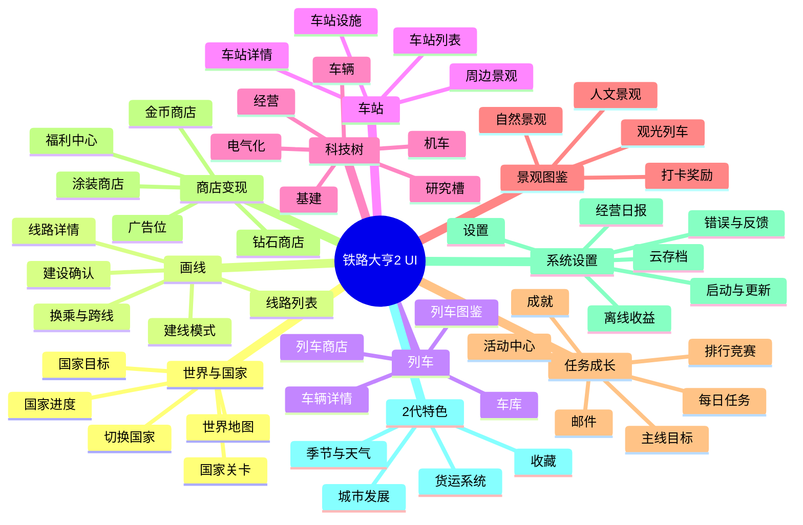
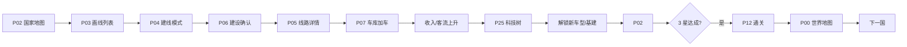

# 铁路大亨 2 · 界面与功能逻辑（v0.2）

> 竖屏 · 日系手绘水彩 · 国家即关卡 · 建线模式拖拽 · 钢铁雄心式科技树 · 公司跨国家经营
> 本稿只做界面与交互逻辑设计，不含游戏代码、工程脚手架或美术资源。
> 参考基线：《地铁线路模拟器》实机录屏（逐秒拆解见 [video-ui-inventory.md](../reference/video-ui-inventory.md)）；前作资产盘点见 [legacy-ui-inventory.md](../reference/legacy-ui-inventory.md)。
> 引擎假设：**Unity 优先，Godot 备选**（见第 11 章）。

---

## 0. v0.2 六项变更（相对 v0.1）

| # | 维度 | v0.1 | v0.2（本稿） | 影响范围 |
|---|---|---|---|---|
| 1 | 地图模型 | 单城街区插画，地铁站距 | **国家铁路地图**：城市节点 + 山川河流海岸 + 沿线景观；站距几十公里 | 主界面、建线、线路详情、车站、地形造价 |
| 2 | 关卡单位 | 城市即关卡，切城经营 | **国家即关卡**：一国一张图，3 星目标，通关解锁下一国；城市降为地图节点 | 世界地图、国家概览、进度、解锁、存档 |
| 3 | 收集物 | 城内街景地标（镇海楼/西湖公园） | **城市周边人文自然景观**（火山/湖泊/古城/神社/海岸/温泉…），线路经过即打卡 | 景观图鉴、打卡弹层、观光收益 |
| 4 | 建线交互 | 地图常驻可拖拽 | **显式「建线模式」**：进入模式后才能拖拽连接，完成/取消退出模式 | 底栏画线、模式条、撤销、误触 |
| 5 | 成长线 | 线性时代演进（蒸汽→内燃→电力→高铁） | **科技树**（钢铁雄心 IV 式）：5 分支 + 研究槽 + 前置 + 时代门槛 + 超前研究惩罚 | 新页面 P25、研究点、时代、国家解锁 |
| 6 | 美术/引擎 | 手绘绘本、Maker/UrhoX | **日系手绘水彩**（和纸/描线/淡彩/季节）；**Unity 2022 LTS 优先，Godot 4 备选** | 全 UI、字体、动效、技术选型 |

> 结论：v0.1 的「四层结构 + 经营外壳」仍成立；**地图、关卡、收集、建线、成长、美术**六块重做。

---

## 1. 一句话定位与核心循环

**一句话**：你是一家跨國铁路公司的经营者，在一个个国家的土地上，用建线模式把城市连成网，用科技树把蒸汽机车升级到高速列车，顺便把沿途的山川古迹收进图鉴。

**核心循环（30 秒）**：
看拥挤/看目标 → 进建线模式拉一段线 → 确认造价与客流 → 加车/升级 → 看收入跳字 → 研究一项科技 → 打卡一个景观 → 下一个国家目标。

**长线循环（一国 2–3 小时）**：
国家目标 3 星 → 解锁下一时代科技 → 通关国家 → 世界地图解锁下一国 → 公司资产/科技/图鉴跨国家继承。

---

## 2. 总思维导图



> 上图为二级总览（10 条主线 + 52 个功能组）；三级细节见第 5 章，或打开 [交互版思维导图](ui-ia-mindmap.html) 逐层展开、搜索、看节点说明。

---

## 3. 界面树（页面 / 入口 / 层级）

```text
P00 世界地图（国家选择，全屏）
 ├─ 国家卡（手绘地图缩略 + 星级 + 时代 + 特色）
 ├─ 已通关 / 当前 / 未解锁（通关前一国 或 钻石解锁）
 └─ 点国家 → P13 国家卡详情 → 进入 P02 或 切换

P01 启动与加载
 ├─ 版本公告 / 云存档恢复
 └─ → P00（首次）或 P02（回访）

P02 国家地图（主界面，常驻）
 ├─ 顶栏：金币+收入/分 ｜ 国家名+国家进度条 ｜ 钻石+加号+齿轮
 ├─ 左侧悬浮列：任务 / 图鉴 / 排行（活动期限时 +1）
 ├─ 右侧悬浮列：收入×2 / 加速 / 领金币（3 个广告位）
 ├─ 底部 4 tab：画线 / 列车 / 车站 / 科技
 ├─ 地图层：城市节点、线路、列车、景观、事件气泡、飘字、站长助手
 └─ 点击对象
     ├─ 城市/车站 → P11 车站详情
     ├─ 线路 → P05 线路详情
     ├─ 景观 → P14 景观卡（首次自动 O05）
     └─ 事件气泡 → O04 随机事件

P03 画线（底部抽屉）：线路列表
 └─ 新建/延长 → P04 建线模式 → P06 建设确认 → P05

P04 建线模式（全屏模式，非普通页面）
 ├─ 模式条：线路色/编号 + 步骤提示（选起点→拖到下一站）+ 关闭
 ├─ 地图：可连接车站高亮、地形造价、预览线
 └─ 底部：撤销（10 秒窗）/ 完成 / 取消

P05 线路详情（底部抽屉）：三宫格 + 票价 + 加车 + 延长/升级/拆除

P07 列车车库（全屏）→ P08 车辆详情 → P09 商店/涂装
P10 车站列表（底部抽屉）→ P11 车站详情（设施升级 + 周边景观）
P12 国家概览（全屏）：目标/城市/景观/日报 + 世界地图入口
P25 科技树（全屏）→ 科技详情/研究队列
P14 景观图鉴 / P15 任务 / P16 图鉴 / P17 排行 / P18 活动 / P19 商店
P20 设置 → P21 存档；P23 离线收益；P24 邮件；P22 经营日报
```

---

## 4. 全局框架

### 4.1 顶栏 HUD（三段式）

- **左：金币胶囊**——金币图标 + 数值（滚动）+ 第二行「收入 474/分钟」。点击 → P19 金币页。
- **中：国家牌**——国旗小标 + 国家名（手写体）+ 下拉箭头；下方「国家进度 19%」+ 细进度条。点击 → P12 国家概览。
- **右：钻石 + 加号 + 齿轮**——钻石数值 + 绿色「+」（→ P19 钻石页）；最右设置齿轮（→ P20）。
- 三段等宽、左右对称，国家名视觉层级最高；数字等宽 + 滚动动画。
- 常驻；底部抽屉打开时保留；全屏页（车库/科技/国家/商店）时隐藏。
- 红点：任务 / 图鉴 / 排行 / 科技完成 / 邮件，按优先级排队（任务 > 科技 > 图鉴 > 排行）。

### 4.2 左侧悬浮列（默认 3 个，活动期 +1）

- 常驻：任务（红点）、图鉴（景观/车辆）、排行。56×56 手绘图标 + 11pt 标签。
- 限时活动开启时，第 4 个「活动」图标（倒计时角标）才出现，结束自动收起。
- 建线模式下整列淡出（模式优先，防误触）。

### 4.3 右侧悬浮列（3 个广告位）

- 收入×2 / 加速 / 领金币，固定 3 个，右上角统一「胶片 + 播放三角」角标。
- 广告永不弹窗：只在这里竖排；金币/研究点不足时，把按钮**原位替换**成「看视频抵扣 / 加速」。
- 经营日报不占右列：入口在 P12 国家概览的数据区（P22）。

### 4.4 底部导航（4 tab，身份色固定）

- **画线（朱红）** / **列车（靛蓝）** / **车站（若草绿）** / **科技（金）**，四等分，身份色永久不变，选中只加托盘，不做整块反色。
- 点 tab 打开默认面板：画线/车站 = 底部抽屉；列车/科技 = 全屏二级页。再点一次关闭。
- 「列车」tab 在有线路拥挤 ≥ 90% 时亮红点。
- 线路身份色跨页面统一：地图线色、线路圆标、车库 tab、操作卡主色（1 朱 / 2 绿 / 3 蓝 / 4 橙 / 5 紫…）。

### 4.5 地图层（国家铁路图）

- **地形**：手绘水彩底图，含山脉、河流、海岸、森林、沙漠；地形决定造价系数（平原 ×1、丘陵 ×1.3、山地 ×2、跨河 ×1.5、海底隧道 ×3）。
- **城市节点**：圆形城市徽章（含小地标剪影）+ 城市名 + 等级；拥挤时红色脉冲环；有景观时角标。
- **线路**：粗描边彩色线 + 虚线施工（若有工期）+ Q 版列车来回跑；选中高亮。
- **景观**：手绘插画小图（火山/湖泊/古城/神社/海岸/温泉），线路经过或车站覆盖半径内自动点亮。
- **事件气泡**：随机事件（暴雨、节日、罢工、检查）出现 30 秒，点击进 O04。
- **飘字**：金币 +N、客流 +N、研究点 +N、升级成功。
- **站长助手**：左下角站长少女 + 三花猫，按状态说一句当前最该做的事。
- 手势：单指平移、双指缩放、双击放大；点击空白关闭面板；不做惯性。

### 4.6 建线模式（v0.2 核心改动）

> 参考游戏是「地图常驻可拖拽」；铁路线更长、误触代价更高，所以改成**显式模式**：进入后 UI 让位、只能建线，完成或取消才退出。

- **进入**：P03「+ 新建线路」/ 线路行「延长」；P05「延长线路」。进入即锁存当前线路草稿。
- **模式条（替换顶栏）**：左侧线路色块 + 「1 号线」+ 步骤提示（① 选择起点 ② 拖到下一站 ③ 继续或完成）；右侧「× 退出」（有草稿时二次确认）。
- **地图态**：非建线 UI 淡出到 15%；可连接车站显示双层脉冲环；不可连接站灰显；地形造价在拖拽时实时显示。
- **拖拽规则**：
  - 从车站按下 → 拖出预览线（吸附最近的可连接站）→ 松手成段。
  - 只能连接有铁路/道路连通的城市（山地需先修隧道科技）、不能跳站、不能重复站。
  - 单线 2–8 站；每段显示「里程 / 造价 / 地形加成」。
  - 继续从端点拖下一段；拖回上一站 = 撤销最后一段。
- **底部浮动条**：总造价 + 预计客流 + 「撤销 10→1」倒数 + 「完成」+「取消」。
- **完成** → P06 建设确认（可改终点/另开新线）→ 确认后退出模式、播放开通动画。
- **取消/退出** → 丢弃草稿（若已有段，弹确认）；回到进入前的页面。
- **模式内禁用**：商店、任务、排行、设置、国家切换；可看线路详情（只读浮层）。

### 4.7 弹层分层（从下到上）

1. 地图层
2. 底部抽屉（画线列表/车站列表）
3. 居中弹窗（建设确认、拆除确认、购买确认、随机事件/宝箱）
4. 全屏页（车库/车站/科技/国家/商店/图鉴/任务/排行/活动/设置）
5. 模式层（建线模式条，最高优先于全屏页）
6. Toast / 飘字 / 引导手指 / 庆祝层

---

## 5. 逐页功能逻辑

> 每页固定七段：目标 / 入口 / 布局 / 控件 / 状态 / 交互 / 出口。数值只是设计默认值，可调。

### P00 世界地图（国家选择，全屏）

- **目标**：跨国家经营的舞台入口；让玩家一眼看到「下一站去哪个国家」。
- **入口**：启动（首次）；P12「世界地图」；通关国家后的自动跳转。
- **布局**：手绘世界/区域地图底图（水彩纸感）；国家以「邮票/明信片」卡片钉在地图上；顶部公司名 + 总资产/总星数；底部图例（已通关/当前/未解锁）。
- **控件**：国家卡 = 国旗 + 国家名 + 手绘地图缩略 + 3 颗星 + 时代标签（蒸汽/内燃/电气/高速）+ 特色标签（岛国/工业/大平原/山地）；未解锁显示「通关 X 国解锁」或钻石价。
- **状态**：当前国家（高亮 + 呼吸光）/ 已通关（星星 + 印章）/ 可解锁 / 锁定 / 加载中。
- **交互**：点国家卡 → P13 国家卡详情；长按看「时代/特色/目标」提示；左右拖动平移世界地图。
- **出口**：P13 / P02 / P12。

### P01 启动与加载

- **目标**：3 秒内看到地图；处理首次下载与云存档。
- **入口**：游戏启动。
- **布局**：Logo + 蒸汽火车跑过的手绘进度条 + 随机铁路小贴士；底部版本号。
- **控件**：进度条、贴士、版本号、云存档冲突二选一。
- **状态**：首次加载（资源 %）/ 热启动 / 更新公告 / 云存档较新。
- **交互**：加载完成淡入 P00 或 P02；冲突 → 对比本地/云端（国家/星数/时间）。
- **出口**：P00 / P02；O11 冲突。

### P02 国家地图（主界面）

- **目标**：所有操作的起点与回程点；一眼看懂「哪条线挤、哪座城能升级、哪个景观能打卡」。
- **入口**：启动、返回、切换国家。
- **布局**：顶栏 + 国家地图 + 左右悬浮列 + 底部 4 tab + 站长助手。
- **控件**：见 4.1–4.5；地图默认居中当前国家首都/第一座城。
- **状态**：默认 / 建线模式 / 面板打开（地图下沉压暗）/ 教学蒙层 / 事件弹窗 / 国家通关庆祝。
- **交互**：点城市→P11；点线路→P05；点景观→P14（首次自动 O05）；点事件→O04；拖拽/缩放；新手引导。
- **出口**：所有页面。

### P03 画线 · 线路列表（底部抽屉）

- **目标**：管理已有线路、进入建线模式。
- **入口**：底栏「画线」tab。
- **布局**：标题「画线」+ 副标题「已建 3/6 条线 · 全国 12 城已连通 7 城」；线路行列表；底部「+ 新建线路」+ 操作说明（进入建线模式后拖拽连接、地形影响造价、换乘站客流 ×1.8）。
- **控件**：行 = 线路色块编号 + 线路名 + 「5 站 · 218km · 收入 320/分」+ 运力条 + 右侧「指引」；未解锁线路灰显 + 条件（科技/国家等级）；底部新建按钮。
- **状态**：空（首条线引导）/ 有线路 / 达线路上限（按钮变「升级科技解锁」）/ 建线模式中。
- **交互**：点行 → 相机聚焦 + P05；点「指引」→ 地图高亮该线；点新建 → P04。
- **出口**：P04 / P05 / 关闭。

### P04 建线模式（全屏模式）

- **目标**：低门槛画出第一条线，随时能反悔；铁路网越长越值钱。
- **入口**：P03 新建/延长；P05 延长线路。
- **布局**：模式条 + 地图 + 底部浮动条（见 4.6）。
- **控件**：车站脉冲环、预览线、造价气泡（里程/单价/地形）、预计客流、撤销、完成、取消、退出。
- **规则**：可连站判定（连通图 + 科技）；2–8 站；不重复；换乘自动生成；地形加成；预算不足时完成按钮变「余额不足」。
- **状态**：选起点 / 拖拽中 / 可完成 / 余额不足 / 达上限 / 有草稿退出确认。
- **交互**：拖拽成段；拖回撤销；完成后 → P06；取消 → 丢弃。
- **出口**：P06 / 返回原页。

### P05 线路详情（底部抽屉）

- **目标**：一条线的全部经营决策在这里完成。
- **入口**：点地图线路；P03 点行；建线完成。
- **布局**：头部（线路色 + 编号 + 名称 + 「5 站 · 218km」+ 关闭/下拉）；三宫格（客流/分 · 运力 % · 收入/分）；站点序列条；票价滑杆；列车行；底部三按钮（延长线路 / 线路升级 / 拆除）；更多（改名/换色/复线/复制）。
- **控件/状态**：票价滑杆实时改客流与收入；加车（不足置灰）；运力 ≥90% 红字 + 站长台词；拆除二次确认并写退回金额；线路升级消耗金币/研究点。
- **交互**：拖滑杆 → 三宫格实时变化；加车 → 扣钱 + 车辆驶入；延长 → 进入 P04；拆除 → O01。
- **出口**：P04 / 升级确认 / O01 / 关闭。

### P06 建设确认（浮层气泡）

- **目标**：开线前把「花多少、赚多少、还能怎么改」讲清楚。
- **入口**：P04 完成；延长完成。
- **布局**：贴地图空白处的小气泡，不挡线路。
- **控件**：标题「延长 1 号线」/「开通 4 号线」；预计客流 +N/分钟；造价 ¥；地形附加说明；「确认建设」主按钮；「取消」；两条快捷改法：「改终点」「另开新线」。
- **状态**：可建 / 余额不足（变「去赚钱」+ 广告入口）/ 预计亏损（黄警告）。
- **交互**：确认 → 扣钱 + 开通动画 + 首班车驶出 + 引导加车；取消 → 回建线模式；改线 → 切换目标。
- **出口**：P05 / P03 / 地图。

### P07 列车 · 车库（全屏二级页）

- **目标**：按线路管理运力，解决拥挤。
- **入口**：底栏「列车」；P05 加车。
- **布局**：全屏，左上返回；线路 tab（用线路身份色）；当前线路摘要（列车数/运力/拥挤度）；三档升级卡（车速 / 编组 / 班次）；车辆卡片列表；底部「+ 加车」。
- **控件**：升级卡 = 等级 + 效果（车速 +%、编组载客 40→60、班次 1→2 列）+ 价格 + 广告角标；金币不足时按钮原位变「看视频立减」。
- **状态**：空线路（引导加车）/ 正常 / 满编 / 拥挤（红提示 + 站长建议）。
- **交互**：切 tab 聚焦线路；升级 → 扣钱 + 数值动画；加车 → 车辆入库动画。
- **出口**：P08 / P09 / 关闭。

### P08 车辆详情 / 升级（抽屉或全屏）

- **目标**：单列车的深度养成与调配。
- **入口**：P07 点车辆卡。
- **布局**：大图机车立绘 + 名称/型号/年代；属性四宫格（速度/载客/维护/舒适）；升级列表；编组；涂装；调配；退役。
- **控件/状态**：属性当前值 + 下一级预览；升级受科技等级限制；编组影响载客与维护；涂装 → P09；调配到其他线路；退役返金币进图鉴。
- **交互**：升级数值滚动；调配飞行动画；退役 O01。
- **出口**：P07 / P09 / 关闭。

### P09 列车商店 / 涂装（全屏）

- **目标**：钻石消耗点：车型、涂装、特权。
- **入口**：P07 商店；P08 更换涂装；钻石不足引导。
- **布局**：顶部钻石余额；tab「列车 / 涂装 / 钻石特权 / 换金币」；卡片网格；底部说明。
- **控件/状态**：未拥有/使用中/已拥有/锁定（科技/国家）；购买二次确认；余额不足去获取。
- **交互**：点卡 → 大图预览 → 购买/使用；成功 → O02。
- **出口**：P07 / P08 / P19。

### P10 车站 · 列表（底部抽屉）

- **目标**：从「线」切到「站」的视角，找拥挤站、可升级站、景观站。
- **入口**：底栏「车站」tab。
- **布局**：筛选 chips（全部/换乘/拥挤/景观/可升级/未连通）；排序（客流/收入/等级）；车站行列表。
- **控件**：行 = 城市徽章 + 城市名 + 所属线路色点 + 客流/分 + 拥挤条 + 等级 + 升级箭头。
- **状态**：空 / 正常 / 红点（拥挤/可升级）。
- **交互**：筛选/排序；点行 → 相机飞过去 + P11。
- **出口**：P11 / P14 / 关闭。

### P11 车站 · 详情 / 设施（底部抽屉）

- **目标**：解决拥挤、提升单站收益、连接景观。
- **入口**：点地图城市；P10 点行；站长提示。
- **布局**：头部（城市名 + 等级 + 线路徽章 + 收藏）；三宫格（客流/分 · 拥挤度 % · 收入/分）；设施升级列表（站台容量 / 候车厅 / 出入口 / 商业设施 / 研发中心）；周边景观 chips；底部（一键升级/改名/观光）。
- **控件/状态**：普通站/换乘站/景观站/拥挤/满级/金币不足；研发中心产出研究点（科技树关键）。
- **交互**：升级 → 扣钱 + 站台长高动画 + 客流飘字；改名（首次免费）；景观 → P14。
- **出口**：P14 / 关闭。

### P12 国家 · 概览（全屏）

- **目标**：一屏回答「这个国家经营得怎么样、还差什么、下一国是谁」。
- **入口**：顶栏国家名；底栏「国家」？——**注意：底栏没有国家 tab，此处从顶栏国家名进入**；P13 切换后。
- **布局**：头部（国旗 + 国家名 + 时代 + 3 星进度 + 国家进度条）；数据网格（城市/线路/里程/客流/收入/维护）；3 条国家目标；景观完成度；城市列表（可点进 P11）；「经营日报」入口；底部「世界地图」+「切换国家」。
- **状态**：新城/成长中/3 星达成/可通关/已通关。
- **交互**：点目标展开奖励；点城市 → P11；点世界地图 → P00；通关 → 庆祝 + 解锁下一国。
- **出口**：P00 / P11 / P22 / 关闭。

### P13 国家卡详情（世界地图浮层）

- **目标**：进入国家前先看「玩什么、有多难、有什么特色」。
- **入口**：P00 点国家卡。
- **布局**：居中大卡：手绘国家插画 + 国旗/国名 + 时代 + 特色（岛国/工业/大平原/山地）+ 3 条目标预览 + 星级 + 特产（景观/车型）+ 主按钮「进入/切换」/「通关 X 国解锁」。
- **状态**：可进入 / 当前 / 已通关（可重玩）/ 锁定。
- **交互**：进入 → 加载 → P02；切换 → 确认（保留进度）。
- **出口**：P02 / P00。

### P14 景观图鉴 / 打卡（全屏 + O05）

- **目标**：把「沿途风景」做成收集玩法，给地图探索一个理由。
- **入口**：左列「图鉴」；地图点景观；P11 周边景观；P12 完成度。
- **布局**：顶部国家 + 完成度环；tab「自然 / 人文」；网格卡（手绘插画 + 名称 + 打卡状态 + 加成）；点卡 → 详情（大图 + 一句风物志 + 奖励 + 打卡）。
- **控件/状态**：未发现（灰色剪影）/ 可打卡 / 已打卡 / 其他国家的（未到访）。
- **交互**：打卡 → O05 明信片庆祝页（拍照框 + 印章 + 奖励 + 看视频翻倍）；集齐一组 → 额外奖励 + 观光列车解锁（P2）。
- **出口**：P02 / P12。

### P15 任务 · 每日 / 成就（全屏）

- **目标**：每日回访理由 + 长期目标。
- **入口**：左列「任务」；完成 toast。
- **布局**：站长插画 + 鼓励语；tab「每日任务 / 成就」；每日：活跃度 20/100 + 3 宝箱（20/70/100）+ 6 条任务行 + 刷新倒计时；成就：分类 chips + 成就卡。
- **控件/状态**：三态按钮「领取（绿）/ 已领（灰）/ 未完成（灰 + 进度）」；奖励钻石 ×10/条；宝箱看视频再领。
- **交互**：领取 → 飞入顶栏；宝箱 → O02 + 广告翻倍；成就达成 → 红点。
- **出口**：关闭。

### P16 图鉴（全屏）

- **目标**：收藏向长线：车辆 / 景观 / 国家。
- **入口**：左列「图鉴」；P07/P08/P09 车辆入口。
- **布局**：tab「车辆 / 景观 / 国家」；收集进度；筛选（时代/国家/类型）；卡片网格。
- **控件/状态**：未解锁剪影 + 获取途径 / 已解锁详情 / 使用中。
- **交互**：点卡 → 详情（立绘/参数/风物志/获取途径）。
- **出口**：关闭。

### P17 排行 / 竞赛（全屏）

- **目标**：轻社交与炫耀；单机 + 云变量排行榜。
- **入口**：左列「排行」。
- **布局**：tab「国家榜 / 好友榜 / 总资产」；我的排名卡；榜单；规则。
- **状态**：未上榜/已上榜/无网络（本地最佳）。
- **交互**：切 tab；点玩家看国家快照（P2）；下拉刷新。
- **出口**：关闭。

### P18 活动 / 福利（全屏）

- **目标**：限时活动、签到、礼包、兑换码。
- **入口**：左列「活动」（活动期出现）；右侧「领金币」→ 福利中心。
- **布局**：活动 banner 轮播；7 天签到；在线奖励倒计时；礼包；兑换码。
- **状态**：可领/已领/未达成/未开始/已结束。
- **交互**：领取 → O02；签到翻牌；兑换码 toast。
- **出口**：关闭。

### P19 商店（全屏）

- **目标**：统一变现：金币/钻石/涂装/特权。
- **入口**：顶栏金币/钻石；钻石不足引导。
- **布局**：余额；tab「钻石 / 金币 / 涂装 / 特权 / 礼包」；卡片网格；恢复购买/说明。
- **控件/状态**：可购买/余额不足/已拥有/限购/首充双倍。
- **实现约束**：UI 不直接调广告 SDK；奖励只在统一发奖层；每次请求独立身份 + 频控 + 幂等；长视频 180s；观看暂停时钟；失败降级。
- **出口**：关闭。

### P20 设置（全屏或抽屉）

- **目标**：系统开关、存档、合规。
- **入口**：顶栏齿轮。
- **布局**：音乐 / 音效 / 震动 / 省电模式 / 排行榜显示 / 上传存档 / 意见反馈 / 隐私政策 / 用户协议 / 关于游戏 / 存档·云存档 / 重开国家（危险）。
- **状态**：默认/省电（降帧关动效）/上传中/成功/失败。
- **交互**：开关即时生效；上传进度 + toast；协议内置页。
- **出口**：P21 / 关闭。

### P21 存档 / 云存档（全屏）

- **目标**：换设备、重装不丢档。
- **入口**：P20；启动冲突。
- **布局**：本地卡（国家/星数/金币/时间）+ 云卡 + 上传/下载/删除。
- **控件/状态**：无云档/云较新/本地较新/上传中/下载确认/冲突。
- **交互**：上传覆盖确认；下载覆盖本地红色高危确认；删除二次确认。
- **出口**：P20 / 关闭。

### P22 经营日报（全屏或抽屉）

- **目标**：讲清「钱从哪来、花到哪去」。
- **入口**：P12 数据区。
- **布局**：今日收入/支出/净收益三卡；7 日趋势柱状；线路 Top5；拥挤 Top5；站长建议。
- **状态**：新玩家数据不足/正常/亏损警告。
- **交互**：点线路→P05；点车站→P11。
- **出口**：P05 / P11 / 关闭。

### P23 离线收益（启动弹窗）

- **目标**：回访奖励 + 广告翻倍。
- **入口**：离线 >10 分钟启动。
- **布局**：站长 + 「你离开了 3 小时 20 分」+ 金币数字 + 领取/看视频 ×2 + 上限说明。
- **状态**：可领/已领/达上限/广告失败降级。
- **交互**：领取 → 金币飞入；×2 → 广告 → 双倍。
- **出口**：P02。

### P24 邮件（全屏）

- **目标**：系统补偿、活动奖励、公告收纳。
- **入口**：顶栏/活动红点；首次进入。
- **布局**：列表（图标/标题/时间/附件状态）+ 详情；一键领取。
- **状态**：未读/已读/已领/过期。
- **交互**：点开标记已读；领取附件 → O02。
- **出口**：关闭。

### P25 科技树（全屏，v0.2 新增核心页）

- **目标**：用《钢铁雄心 IV》式的树状研发，替代线性时代演进；把「先点哪条」变成策略。
- **入口**：底栏「科技」tab；新科技可用时的红点；P05「线路升级」内的科技跳转。
- **布局**：
  - 顶部：时代刻度条（1830 / 1870 / 1900 / 1930 / 1960 / 2000）；右侧研究点余额 + 研究槽（2 个，可买第 3 个）。
  - 主体：6 列（时代）× 5 行（机车 / 车辆 / 基建 / 电气化 / 经营）的节点网格；节点用图标 + 名称 + 状态；前置用连线；当前可研高亮。
  - 底部：选中节点详情条（效果 / 研究点 / 时长 / 前置 / 研究按钮）。
- **控件**：
  - 节点状态：已研发（点亮 + 勾）/ 可研发（描边高亮）/ 前置未满足（灰 + 锁）/ 时代未到（暗 + 年份）/ 研究中（进度环）。
  - 研究槽：点击空槽 → 选一个可研发节点 → 消耗研究点 + 开始倒计时（1–20 分钟，可用广告/钻石加速）。
  - 队列：最多排 3 个；槽满时提示。
  - 超前研究：研发高于当前国家时代的科技，研究点 ×2（保留 HoI4 的「超前惩罚」）。
- **状态**：时代上限（每国设最高时代）/ 研究点不足 / 槽满 / 研究中 / 完成待领。
- **交互**：拖动平移 + 双指缩放树；点节点看详情；长按看前置链；研究完成 → 顶部 toast + O02；时代突破 → 全屏庆祝 + 新车型解锁。
- **出口**：关闭；跳转 P05/P07。

### P26 科技节点详情（浮层）

- **目标**：不离开树就能判断「值不值得点」。
- **入口**：P25 点节点。
- **布局**：小卡：图标 + 名称 + 时代 + 一句话 + 效果列表（数值增减）+ 前置 + 研究点/时长 + 「研究」按钮。
- **状态**：可研究/研究中/已完成/前置缺失/时代未到/研究点不足。
- **交互**：研究 → 占用槽 + 倒计时；查看前置 → 树自动定位并高亮。
- **出口**：P25。

---

## 6. 核心流程

### 6.1 首次进入 / 切换国家

启动 → P00 世界地图 → 点「日本（教学）」→ P13 国家卡 → 进入 → P02 国家地图 → 新手引导（看顶栏 → 点第一座城 → 进建线模式拉第一条线）。

回访：P01 → 直接 P02（上次国家）→ P23 离线收益 → 任务红点。

切换国家：P02 点国家名 → P12 → 「世界地图」→ P00 → 选已解锁国家 → P13 → 切换（保留各国进度）。

### 6.2 建线（v0.2 主流程）

1. 底栏「画线」→ P03 线路列表 → 「+ 新建线路」。
2. 进入 **P04 建线模式**：顶栏变模式条，其余 UI 淡出。
3. 按下起点城市 → 拖到相邻可连城市 → 松手成段；继续拖下一段。
4. 每段实时显示里程/造价/地形加成；底部累计总造价与预计客流。
5. 误操作：拖回上一站，或点「撤销 10→1」。
6. 点「完成」→ P06 建设确认（预计客流 +N/分、造价、改终点/另开新线）。
7. 确认 → 扣钱 + 开通动画 + 首班车 + 引导加车 → 退出模式。
8. 取消/退出 → 丢弃草稿（有段则二次确认）。

### 6.3 加车 / 解决拥挤

P02 看到城市红圈或线路运力红字 → 点线路 → P05 三宫格运力 ≥90% → 「+ 加车」→ 金币不足则「看视频立减」→ 车辆驶入 → 运力下降 → 站长台词变「这下松快多了♡」。

### 6.4 科技研究

P25 科技树 → 点可研节点 → P26 详情 → 「研究」→ 占用研究槽 + 扣研究点 + 倒计时 → 完成 toast → 新车型/新能力解锁 → 回 P05/P07 使用。

研究点来源：车站「研发中心」设施产出（主力）+ 国家目标 + 每日任务宝箱 + 广告。

### 6.5 景观打卡

线路首次经过景观半径 / 车站覆盖景观 → 自动弹 **O05 明信片庆祝页**（拍照框 + 印章 + 风物志一句 + 附近车站客流 +15% + 钻石 ×20 + 看视频再领）→ 收下 → P14 图鉴点亮 → 集齐一组发套组奖励。

### 6.6 国家通关 → 世界地图

P12 三条国家目标全部达成 → 3 星 → 「通关国家」→ 庆祝页（印章 + 国旗 + 总资产结算）→ 解锁下一国 + 时代上限提升 → 回 P00 世界地图 → 选下一国。

### 6.7 回访 / 离线

启动 → 离线时长 → P23 离线收益（领/×2）→ P22 日报提示昨日问题 → 任务/科技红点 → 日常循环。



---

## 7. 科技树专章（钢铁雄心 IV 式）

### 7.1 借鉴什么、改什么

| 钢铁雄心 IV | 本作（移动端） |
|---|---|
| 按年份分列、跨列前置、树状连线 | 保留：6 个时代列 × 5 条分支 |
| 研究槽 + 天数倒计时 | 保留：2 个槽（可扩到 3）+ 1–20 分钟倒计时，可广告加速 |
| 超前研究惩罚 | 保留：高于当前国家时代的研究点 ×2 |
| 大量历史装备小图标 | 收敛：每分支 4–6 个节点，一局看到全貌 |
| 陆军/海军/空军/工业多页 | 收敛为 5 条：机车 / 车辆 / 基建 / 电气化 / 经营 |

### 7.2 五条分支（首版节点示例）

| 分支 | 节点（按时代） | 主要效果 |
|---|---|---|
| **机车** | 蒸汽 0 系 → 蒸汽 1 系 → 内燃机车 → 电力机车 → 高速动车组 | 速度、牵引定数、解锁车型 |
| **车辆** | 木制客车 → 钢制客车 → 餐车 → 观光车厢 → 双层客车 | 载客、舒适度、观光收入 |
| **基建** | 轻轨 → 标准轨 → 复线 → 桥梁加固 → 山岭隧道 → 海底隧道 | 允许连线地形、造价降低、运力上限 |
| **电气化** | 接触网 → 变电所 → 再生制动 → 信号自动闭塞 | 电力车型、能耗下降、班次上限 |
| **经营** | 票价策略 → 车站商业 → 广告合作 → 研发中心 → 观光营销 | 收入系数、研究点产出、广告收益 |

### 7.3 研究规则（设计默认值）

- **研究点（RP）**：车站「研发中心」每级 +N/分钟；国家目标 +200；每日宝箱 +50；广告 +30。
- **研究槽**：初始 2 个；第 3 槽用钻石/月卡解锁。
- **时长**：1 分钟（早期）→ 20 分钟（晚期）；可用广告减半、钻石立即完成。
- **队列**：最多 3 个，槽空自动开始。
- **时代上限**：每个国家设「最高时代」（日本=1900、英国=1930、美国=1960、瑞士=2000）；完成国家目标后上限 +1。
- **超前惩罚**：研发高于当前时代 1 列的节点，研究点 ×2；跨越 2 列禁止。
- **重置**：科技树是**公司级**，跨国家保留（这是「公司成长」的主线）。

### 7.4 科技树 UI 规范

- 节点：88×88 圆角方卡（图标 + 名称 2 行），已研/可研/锁定/研究中四态；连线 2px 手绘墨线，前置满足时描边点亮。
- 时代列头：年份木牌 + 该时代进度（已研/总数）。
- 缩放：默认 0.75，范围 0.5–1.4；拖动平移；双击节点聚焦。
- 研究槽固定在顶部，不随树滚动；底部详情条随选中节点变化。

---

## 8. 国家关卡与景观系统

### 8.1 首版四个国家（建议）

| 国家 | 时代 | 地形特色 | 玩法特色 | 教学 |
|---|---|---|---|---|
| **日本** | 明治–大正（蒸汽） | 岛国、山地、海峡 | 海峡隧道科技、观光线、樱花季节 | ✅ 教学关 |
| **英国** | 维多利亚（蒸汽黄金） | 丘陵、工业城市密集 | 高密度短途、复线、通勤 | — |
| **美国** | 内燃（1960） | 大平原、沙漠、长距离 | 长交路、货运（P2）、大编组 | — |
| **瑞士** | 电气化（2000） | 阿尔卑斯、湖泊、隧道 | 山地隧道、观光列车、准点率 | — |

> 后续版本可加：中国（高铁）、法国（TGV）、印度（殖民铁路）等。**中国是否首发**见第 13 章待拍板。

### 8.2 国家关卡的三个结构

1. **3 星目标**（示例）：连通 6 座城市 / 客流 1,200/分 / 累计净利 ¥50K；三条全达成 = 3 星 = 通关。
2. **国家进度** = 目标完成度 60% + 城市连通率 25% + 景观收集 15%；顶栏进度条即此值。
3. **国家特色**：每国一个独有机制（日本=海峡隧道、英国=通勤高峰、美国=长交路补贴、瑞士=准点率奖励），避免四国只是换皮。

### 8.3 景观系统（替代城内街景地标）

- **两类**：
  - **自然景观**：火山、湖泊、瀑布、海岸、温泉、樱花林、枫叶谷、雪山、沙漠奇观。
  - **人文景观**：古城、神社/寺庙、城堡、灯塔、运河、老车站、铁道博物馆、工业遗址。
- **分布**：钉在国家地图的城市周边（不占城市内部），线路经过或车站覆盖半径（约 15km）内自动点亮。
- **奖励**：附近车站客流 +15% / 观光收入 +N / 钻石 ×20 / 图鉴条目；集齐「一国 6 景」→ 套组奖励 + 观光列车（P2）。
- **打卡页（O05）**：明信片式——手绘风景 + 白相纸边 + 邮戳 + 「打卡成功」印章 + 一句风物志 + 奖励 + [收下]/[看视频再领 ×2]。
- **图鉴（P14）**：按国家/自然/人文分组，完成度环；未发现显示剪影 + 模糊提示（「在山的那边…」）。

### 8.4 国家通关与重玩

- 通关后保留该国存档，可随时回去补星/补景观；重玩不覆盖原进度（另开「挑战档」P2）。
- 世界地图上已通关国家盖「印章」；总星数 = 公司等级来源。

---

## 9. 弹层、红点与空态

### 9.1 弹层清单

| 编号 | 弹层 | 触发 | 关键内容 | 关闭 |
|---|---|---|---|---|
| O01 | 通用确认 | 拆除、购买、覆盖存档、退役、重开国家 | 标题 + 说明 + 主/次按钮（危险红） | 按钮（危险不可点遮罩关） |
| O02 | 奖励获得 | 任务、宝箱、打卡、成就、购买、研究完成 | 物品图标 + 数量 + 来源 | 点击 / 3s |
| O03 | 解锁 / 成就 | 新线路、新国家、新车型、新科技 | 立绘 + 名称 + 分享 | 点击 |
| O04 | 随机事件 | 定时/条件触发 | 插画 + 描述 + 2 个抉择（橙=人情，绿=收益，灰=花钱）+ 30s 超时 → toast「已处理：…」 | 选择 / 超时 |
| O05 | 景观打卡 | 线路首次覆盖景观 | 明信片 + 邮戳 + 风物志 + 奖励（客流 +15%、钻石 ×20）+ [收下]/[看视频再领] | 收下 / 看视频 |
| O06 | 广告加载/结果 | 所有广告位 | 加载中/失败重试/成功奖励 | 自动 |
| O07 | Toast / 飘字 | 操作反馈 | 一句话 / 金币数字 | 自动 |
| O08 | 教学蒙层 | 新手引导 | 高亮 + 手指 + 文案 + 跳过 | 完成 / 跳过 |
| O09 | 开通庆祝 | 新线开通 / 科技时代突破 | 礼花 + 线路名/时代名 + 首班车 | 自动 / 点击 |
| O10 | 网络/资源错误 | 请求失败 | 原因 + 重试 | 重试 / 关闭 |
| O11 | 云存档冲突 | 启动检测 | 本地 vs 云端 | 二选一 |

### 9.2 红点规则

- 任务：有可领任务 / 宝箱可开。
- 科技：有可研节点且槽位空闲 / 研究完成待领。
- 图鉴：新景观可打卡。
- 排行：赛季结算 / 名次变化（低优先级）。
- 列车：任意线路拥挤 ≥ 90% 或可升级。
- 车站：拥挤（不提示「可升级」，避免疲劳）。
- 活动（限时）：可领奖励。

### 9.3 空态 / 异常态

- 无线条：引导拉第一条线（地图高亮两座城 + 建线模式）。
- 无车辆：引导加车。
- 无研究点：提示建研发中心 / 看广告。
- 无网络：排行榜本地最佳、云存档置灰。
- 金币为负：救援弹窗（看广告补到基准），禁止继续建设。
- 广告失败：降级普通奖励，不阻断。
- 建线模式中断（来电/切后台）：草稿保留 10 分钟，回来可继续。

---

## 10. 视觉规范：日系手绘水彩

### 10.1 色彩

| 用途 | 建议色值 | 说明 |
|---|---|---|
| 和纸底 | #F6EFE3 | 地图/面板底，带纸纹 |
| 纸底深 | #EADFCB | 分区/次级面板 |
| 墨线 | #2F2A26 | 描边、正文（不用纯黑） |
| 朱 | #C8553D | 主按钮、线路 1、印章 |
| 樱 | #E8A0B4 | 强调、季节装饰 |
| 靛 | #3B5A8C | 线路 2、信息 |
| 若草 | #6FA05A | 线路 3、成功 |
| 金 | #D9A94E | 奖励、科技 |
| 山蓝 | #7E9FB8 | 远山、水面 |
| 白 | #FFFDF6 | 卡片内白 |

- 线路色板：朱 / 若草 / 靛 / 橙 / 紫 / 山蓝 / 樱 / 棕，8 色循环，色盲安全。
- 季节变色：春樱、夏绿、秋枫、冬雪，低饱和叠加，不影响可读性。

### 10.2 字体

| 场景 | 字体 | 字号（1080×1920） |
|---|---|---|
| 标题/城市名 | 手写圆体 / 明朝体（二选一，全作统一） | 44–52 Bold |
| 数值 | 等宽数字 + 圆体 | 34–40 Bold |
| 正文/列表 | 思源黑体 / 圆体 | 26 Regular |
| 说明小字 | 同上 | 22 Regular，60% 墨色 |
| 风物志 | 明朝体 | 24，行距 1.8 |

### 10.3 组件语言

- **纸卡**：米白纸底 + 2px 墨线描边 + 手绘阴影；圆角 12–16。
- **胶带/图钉**：标题卡、公告、打卡页用胶带贴角。
- **印章**：通关、打卡、成就用朱红印章（轻微旋转 + 墨迹不匀）。
- **车票**：任务/奖励/商店用「硬券车票」样式（打孔边）。
- **图标**：单色墨线 + 一色块，线宽统一 2.5px，圆头。
- **按钮**：主按钮朱红实心 + 墨线描边 + 内阴影；次按钮纸白 + 墨线；危险按钮深朱 + 斜纹。

### 10.4 插画与动效

- 插画：水彩晕染 + 铅笔描线，留白多；城市=建筑群剪影，景观=单幅风景。
- 站长 + 三花猫：常驻左下，Q 版，表情 6 种（开心/着急/思考/惊讶/困/得意）。
- 动效：翻页（面板）、盖章（打卡/通关）、墨迹扩散（解锁）、樱花飘落（季节）、列车驶过（开通）。
- 时长：交互反馈 120–180ms；面板 240ms；庆祝 1.2s 可跳过。

---

## 11. 引擎与实现约束（Unity 优先，Godot 备选）

### 11.1 选型对比

| 维度 | Unity 2022 LTS | Godot 4.3 | 结论 |
|---|---|---|---|
| 2D 手绘/水彩表现 | URP 2D + Shader Graph，滤镜/纸张质感成熟 | CanvasItem + 自定义 shader，轻量 | Unity 略优 |
| UI 系统 | UGUI（成熟）/ UI Toolkit（新） | Control 节点，迭代快 | 都可行 |
| 地图与线 | SpriteRenderer + LineRenderer + 自定义 mesh | Line2D + TileMapLayer | 都可行 |
| 移动端 SDK（TapTap 登录/广告/支付） | 官方 SDK/社区插件成熟 | 需 Android 插件封装 | **Unity 优** |
| 包体/启动 | 较大（可裁剪） | 小 | Godot 优 |
| 团队/资产生态 | 大 | 中 | Unity 优 |
| 热更/发版 | 成熟 | 一般 | Unity 优 |

**建议**：Unity 2022 LTS + URP 2D + UGUI（首版不上 UI Toolkit）+ Addressables；Godot 4 作为「小包体/独立版」备选，不作为首发。

### 11.2 关键实现约束（设计侧约定）

- **分辨率**：设计稿 1080×1920 竖屏；CanvasScaler「Scale With Screen Size」1080×1920，match 0.5；全部页面做安全区（刘海/底部手势条）。
- **地图**：单张国家底图（2–4K，多分辨率切图）+ 城市/景观/线路矢量层；地形造价用高度/河流 mask 采样，不靠手填。
- **建线模式**：独立状态机（Normal / BuildMode / Confirm），进模式时禁用其他 UI 射线；拖拽用「按下站→拖拽→吸附最近可连站」；预览线用 LineRenderer，结束提交数据。
- **UI 性能**：长列表（车站/任务/图鉴）用虚拟列表；图鉴缩略图走图集；同屏 draw call 控制。
- **存档**：JSON + 版本号 + bak 双写；云存档抽象层（Unity 可用 TapTap 云变量/自建）。
- **广告**：统一 AdService 适配层 + claimReward(slot) 奖励层；UI 不直连 SDK；频控/幂等/降级。
- **数值**：全部走配置表（ScriptableObject / JSON），禁止硬编码；发版前跑数值校验。
- **本地化**：文本 key 化，中文优先，预留英文/日文（日系画风适合出海）。

### 11.3 与旧工程的关系

- 旧工程 global-rail-tycoon-maker（Maker/UrhoX Lua）**不再作为本作基础**，仅作资产/数值/踩坑参考。
- 本作在 Railway2_unity 新建 Unity 工程；本文档不创建工程、不写代码。

---

## 12. 优先级与版本切分

### P0 — 首个可玩垂直切片（一国、一线、一车、一科技）

1. P00 世界地图（仅 1 国可进）+ P01 启动
2. P02 国家地图 + 顶栏 + 底栏 + 左右悬浮列
3. P03 画线列表 + P04 建线模式 + P06 建设确认 + P05 线路详情
4. P07 车库 + P08 三档升级（车速/编组/班次）
5. P10 车站列表 + P11 车站详情（站台/候车厅/研发中心）
6. P25 科技树（每分支 2 个节点，2 研究槽）
7. P14 景观图鉴（6 个景观）+ O05 打卡
8. P15 每日任务（最小集）+ P20 设置 + P21 云存档 + P23 离线
9. 广告 2 个（收入×2、离线翻倍）+ 新手引导

### P1 — 留存与商业化

- P12 国家概览 + P13 国家卡 + 世界地图多国 + 国家通关
- P09 商店/涂装、P16 图鉴、P17 排行、P18 活动、P22 日报、P24 邮件
- 科技树扩到 5 分支 × 4 节点、第 3 研究槽
- 成就系统、随机事件、线路升级、列车调配

### P2 — 差异化与长线

- 货运系统、观光列车、季节与天气、城市地块成长、跨洲/全球地图
- 更多国家（中国高铁、法国、印度…）、更多景观套组、赛季/竞赛、分享
- 重玩挑战档、创意工坊（若平台允许）

**判断**：P0 只做「日本 + 6 城 + 1 条线 + 1 台蒸汽机车 + 1 项科技」，跑通后再铺国家与科技树。

---

## 13. 待拍板问题

1. **首版国家与顺序**：日本教学 → 英国 → 美国 → 瑞士？**中国要不要首发**（还是作为首个大版本更新）？
2. **世界地图范围**：4 国（区域图）还是全球地图（后续加国）？建议首版 4 国、用区域图，避免全球地图美术量。
3. **科技树归属**：公司级跨国家保留（建议）还是每国重置？两者留存与难度曲线完全不同。
4. **研究是否要真实等待**：1–20 分钟倒计时（建议，配广告加速）还是纯研究点即时解锁？
5. **建线是否必须站到站**：建议必须连接城市/车站（铁路逻辑），不做自由画线；是否允许「规划中」虚线（先占位后施工）？
6. **引擎最终选择**：Unity（建议）还是 Godot？是否仍要发布 TapTap（影响 SDK 与账号体系）？
7. **日系浓度**：绘本水彩（建议，接近吉卜力静态）还是动画赛璐璐（更二次元、角色更突出）？
8. **国家是否用真实国名/国旗**：真实（沉浸、易理解）还是架空（规避敏感）？建议真实国名 + 架空公司/人物。

---

## 14. 附录

- 参考视频逐秒拆解、15 个界面、11 条流程：[video-ui-inventory.md](../reference/video-ui-inventory.md)
- 前作 v1.8.0 资产盘点（15 项可继承 / 12 项必重做 / 25 条踩坑）：[legacy-ui-inventory.md](../reference/legacy-ui-inventory.md)
- v0.1 设计稿（单城地铁骨架，已归档）：[archive/ui-ia-mindmap-v0.1.md](archive/ui-ia-mindmap-v0.1.md)

---

*本稿只做界面与交互逻辑设计，不含任何游戏代码、工程脚手架或美术资源。*
