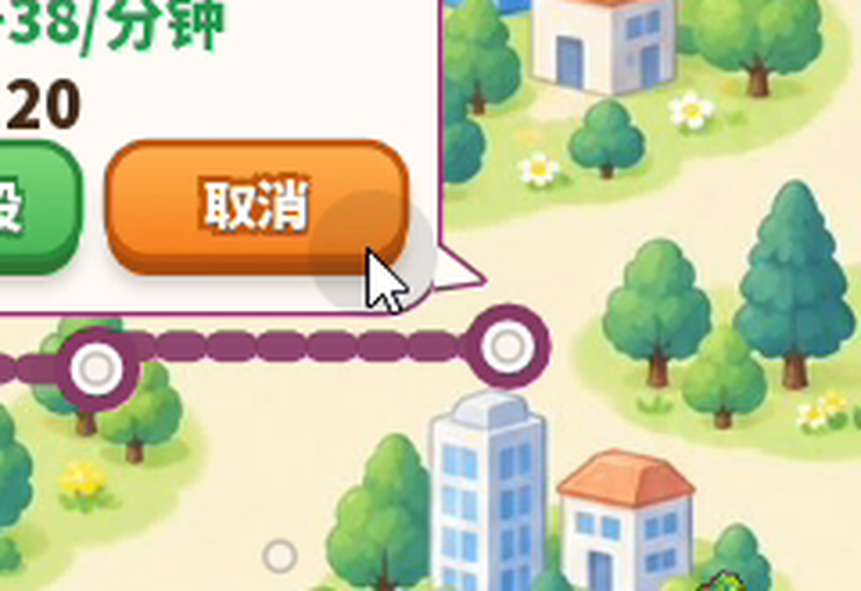
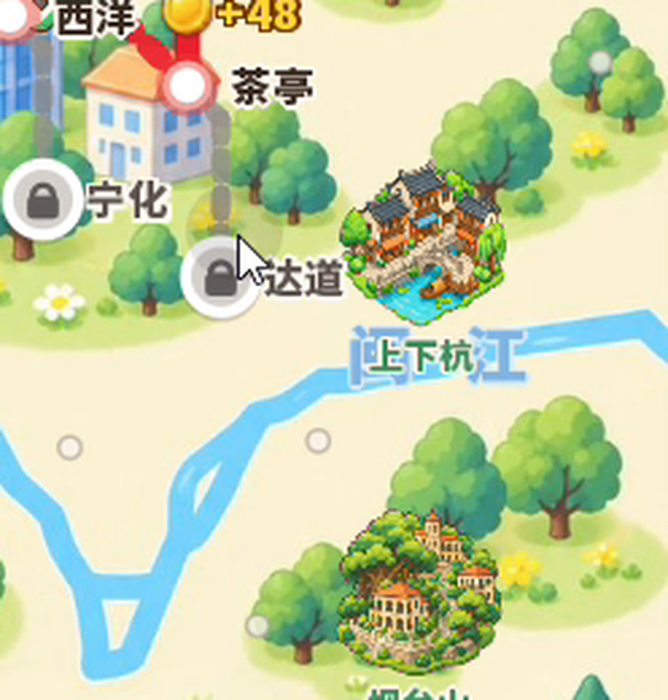
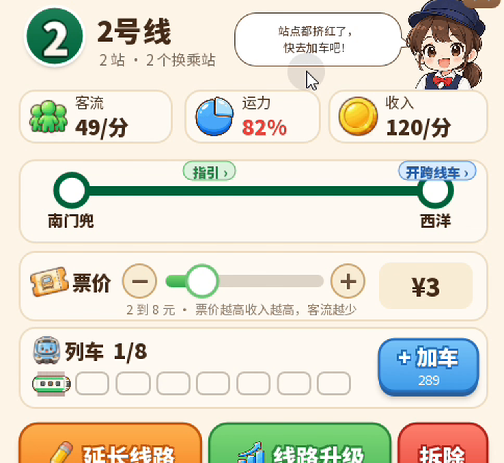
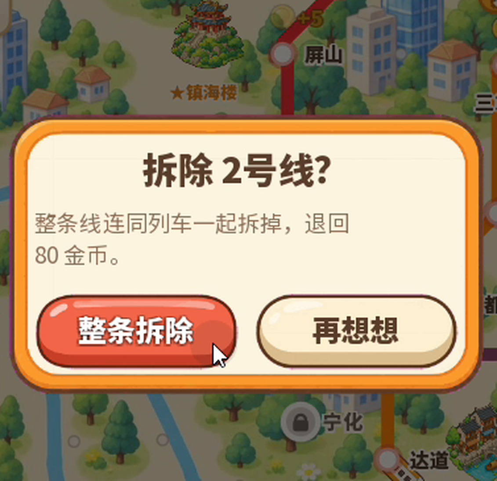
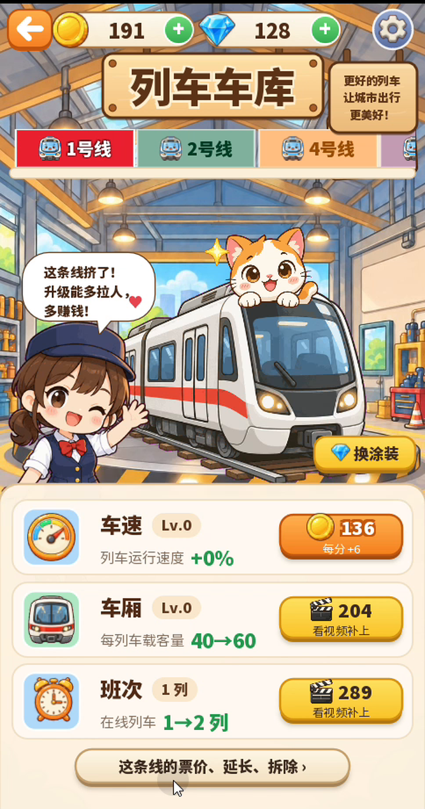
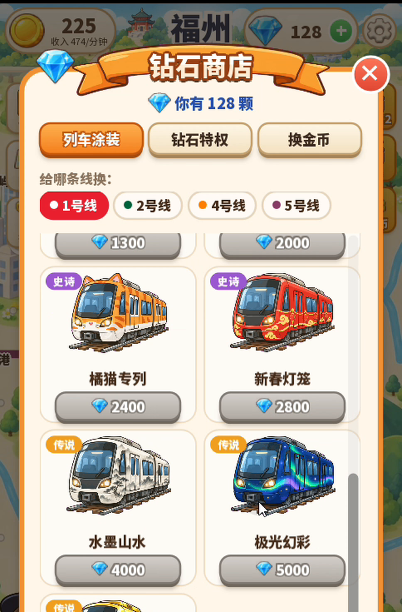
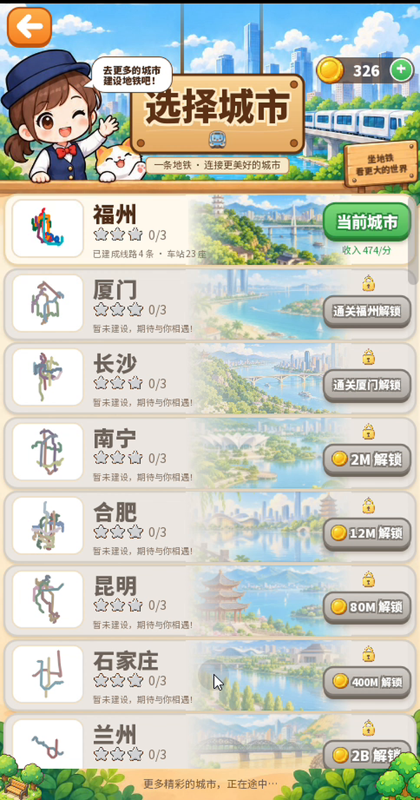
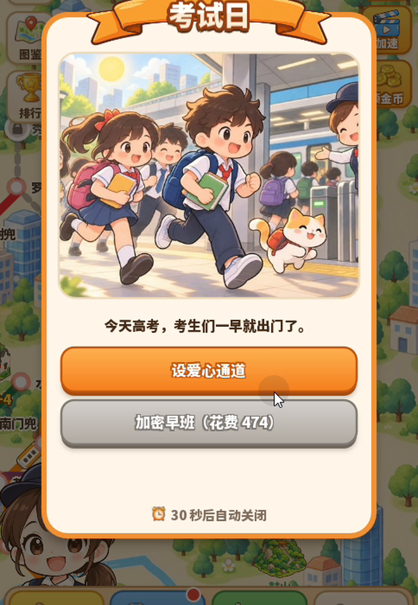
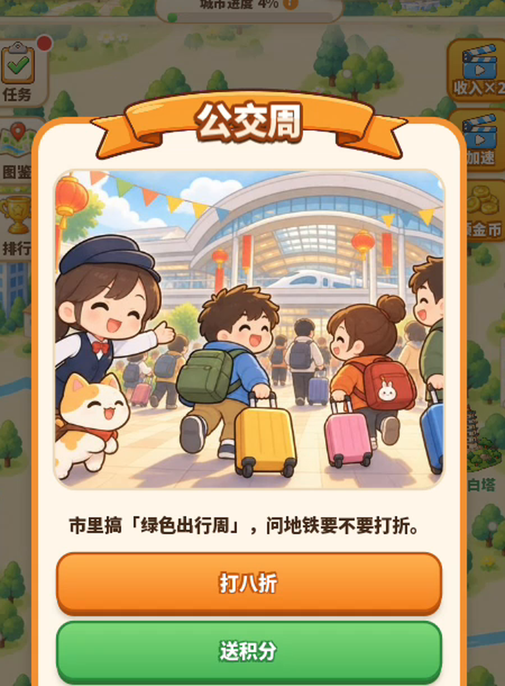

# 参考视频 UI 全量清单 ·《地铁线路模拟器》（TapTap）

> 拆解对象：E:/aigc/Railway2_unity/video/20261110-111142.mp4
> 规格：141.03s / 484×946 竖屏 / 30fps，Windows 窗口内运行（顶部"地铁线路模拟器"标题栏为录屏窗口，**不属于游戏 UI**）
> 帧素材：E:/aigc/Railway2_unity/.tmp/frames/f000_0000.00.png … f141_0141.00.png（1fps）。**本文中 fNNN 即第 NNN 秒的帧**
> 截图：本文引用的裁剪图保存在 docs/reference/frames/（文件名见 §7）
> 用途：作为《铁路大亨 2》竖屏界面与信息架构的参考基线，**本文只做拆解，不含实现代码**

---

## 0. 一句话结论

这是一套 **"单城地图即主界面（sticky HUD）+ 底部 4 tab + 底部抽屉面板 + 全屏二级页"** 的四层结构：
地图永远是背景；所有经营操作要么是**地图上的浮动操作卡**（建线/延长），要么是**从底部升起的抽屉**（线路详情/画线），
要么是**盖住全屏的二级页**（列车车库/城市/任务/商店）。**没有任何一个确认框是纯文字**——全部带插画 + 手绘风按钮。

---

## 1. 时间轴总览（0–141s 逐段）

| 时间 | 帧 | 这一段在做什么 |
|---|---|---|
| 0s | f000 | 进游戏即弹**随机事件「公交周」**（绿色出行周：打八折/送积分），背景已压暗 |
| 1–3s | f001–f003 | 主地图空闲态。金币 2378/2379，收入 **240/分钟**，钻石 **20**，城市进度 **4%**，1 号线已有 4 站 |
| 4s | f004 | 拖动端点延长 1 号线 → 弹出**「延长 1号线」规划卡**（预计客流 +26/分钟，造价 78） |
| 5–8s | f005–f008 | 确认建设，1 号线延伸到**屏山**；金币下降；右下出现**「撤销 N」倒计时**（10→1 秒） |
| 12s | f012 | 顶部黑色 toast：**「屏山：还没通地铁，从附近的站拖线过来」**；撤销倒计时剩 4 |
| 15s | f015 | 钻石 **20 → 40** |
| 16s | f016 | **打卡地标「镇海楼」**全屏弹窗（新地标解锁！） |
| 17–22s | f017–f022 | 继续延长 1 号线，城市进度 **5%**，收入升到 474/分钟 |
| 23s | f023 | **「延长 1号线」规划卡**（＋20/分钟，造价 173） |
| 24–32s | f024–f032 | 地图巡航：1 号线已连 秀山–罗汉山–树兜–屏山–东街口–南门兜–西洋–茶亭 |
| 33–37s | f033–f037 | 钻石 **40 → 80**；连续两次**打卡地标「烟台山」「上下杭」** |
| 38–56s | f038–f056 | 开新线：**「新建 5号线」卡（＋38/分钟，造价 320）**、延长 4/5 号线，线路详情反复开关 |
| 58–59s | f058–f059 | 开通 5 号线；金币 1660→1194→910（建线花费） |
| 60–66s | f060–f066 | 打开**线路详情抽屉「2号线」**（2 站·2 个换乘站 / 客流 49/分 / 运力 82% / 收入 120/分 / ¥3 / 列车 1/8） |
| 67s | f067 | **拆除确认弹窗「拆除 2号线?」**（退回 80 金币），背景压暗 |
| 68s | f068 | toast **「已拆除2号线」**，金币回补 |
| 70–71s | f070–f071 | 线路详情「1号线」（8 站·1 个换乘站 / 客流 102/分 / 运力 39%）→ 拆除 → toast「已拆除1号线」 |
| 72–82s | f072–f082 | 重画 4/5 号线；地标 三坊七巷 / 西湖公园 出现 |
| 83–84s | f083–f084 | 钻石 **80 → 100**；**打卡「西湖公园」** |
| 89s | f089 | 钻石 **100 → 120**；**打卡「于山白塔」** |
| 90–96s | f090–f096 | 补线、加车、站点点亮 |
| 97s | f097 | **随机事件「考试日」**弹窗（设爱心通道 / 加密早班 花费 474） |
| 98s | f098 | 钻石 **120 → 128**（事件处理奖励，未直接看到奖励弹窗） |
| 99s | f099 | toast **「已处理：设爱心通道」** |
| 100–103s | f100–f103 | **列车车库**全屏页（1/2/4/5 号线 tab：车速 / 车厢 / 班次 三档升级） |
| 104–107s | f104–f107 | **钻石商店**（列车涂装 / 钻石特权 / 换金币，13 款涂装网格） |
| 108–110s | f108–f110 | **设置**面板（音乐/音效/震动/省电/排行榜 + 4 条文档入口 + 存档） |
| 111–112s | f111–f112 | 回地图 |
| 113–117s | f113–f117 | **「画线」抽屉**（已建 4/6 条线 + 6 行线路清单 + 4 行操作提示） |
| 118s | f118 | 地图 |
| 119–131s | f119–f131 | **「选择城市」全屏页**，滚动浏览 8 座城市（福州→兰州） |
| 132s | f132 | 回地图 |
| 133–138s | f133–f138 | **「每日任务 / 成就」全屏页**；f136 弹出**「宝箱打开了！」视频翻倍弹窗** |
| 139–141s | f139–f141 | 收尾地图态：金币 501，收入 474/分钟，钻石 **158**，城市进度 **19%**，5 条线 |

### 1.1 右侧钻石数字的完整变化链（重点）

| 变化 | 时间 | 帧 | 来源 |
|---|---|---|---|
| 20（初始） | 0–14s | f000–f014 | 开局送 |
| 20 → **40** | 15s | f015 / f016 | 打卡地标「镇海楼」钻石 ×20 |
| 40 → **80** | 33–34s | f033 / f034 | 连续打卡「烟台山」+「上下杭」，各 ×20 |
| 80 → **100** | 83s | f083 | 打卡「西湖公园」×20 |
| 100 → **120** | 89s | f089 | 打卡「于山白塔」×20 |
| 120 → **128** | 97–98s | f097 / f098 | 随机事件「考试日」处理奖励（+8，录屏未展示奖励弹窗） |
| 128 → **158** | 133–139s | f133–f139 | 每日任务领奖 +10、活跃度宝箱 +10、宝箱视频 +10（共 +30） |

> 结论：**右侧数字 = 钻石（IAA/内购货币）**，唯一稳定来源是"打卡地标"与"任务/宝箱"。
> 左侧数字 = **金币**，副行是**收入/分钟**（随线路数与客流增长：240 → 474/分钟）。

---

## 2. 全局 HUD（主地图常驻层）

### 2.1 顶栏（三段式，贴在状态栏下方）

| 位置 | 元素 | 文案 / 字段 | 说明 |
|---|---|---|---|
| 左 | 金币胶囊 | 大数字 **501** + 副行 **收入 474/分钟** | 金币图标在左；副行更小、灰棕色；数字=当前持有，副行=流量产出速率 |
| 左中 | 城市地标缩略图 | 镇海楼插画 | 装饰 + 城市身份识别，不可点 |
| 中 | 城市名 | **福州**（特大号深蓝描边字） | 当前城市名 |
| 右 | 钻石胶囊 | 钻石图标 + **158** + 绿色 **[+]** 圆钮 | [+] 打开**钻石商店**（f104），即广告/内购入口 |
| 最右 | 齿轮 | ⚙ | 打开**设置**（f109） |
| 下方居中 | 城市进度 | **城市进度 19%** + [ⓘ] + 绿色进度条 | ⓘ 可点（录屏未点）；进度 4%→5%→16%→19% |

- 布局要点：金币胶囊与钻石胶囊**左右对称**，城市名压在中间最高层（白描边+投影），齿轮为独立圆形按钮。
- 顶栏在**除全屏二级页外**的所有界面都在（线路详情/画线抽屉/商店/设置/事件弹窗都保留顶栏，只压暗）。
- **全屏二级页换成自己的顶栏**：左「←」返回、右「金币 xxx [+]」（城市页/任务页），或「金币 / 钻石 / ⚙」（列车车库）。

### 2.2 左悬浮列（3 个，竖排，贴左）

| 序号 | 图标 | 文案 | 状态 |
|---|---|---|---|
| 1 | 绿色对勾剪贴板 | **任务** | 常驻**红点**（有可领任务） |
| 2 | 展开地图 + 红色定位针 | **图鉴** | 无红点 |
| 3 | 金奖杯 | **排行** | 无红点 |

- 均为「图标在上、两字文案在下」的圆角方卡（米色底 + 棕色描边），间距约 8px。
- 录屏中**三个都没点开**（见 §3.15）。

### 2.3 右悬浮列（3 个，竖排，贴右，全部带广告播放角标）

| 序号 | 图标 | 文案 | 含义 |
|---|---|---|---|
| 1 | 蓝色胶片 + 播放键 + 黄底标签 | **收入×2** | 看广告，全局收入翻倍（限时 buff） |
| 2 | 同上 | **加速** | 看广告，加速（游戏内倍速） |
| 3 | 金币堆 | **领金币** | 看广告领金币 |

- 统一为**橙黄渐变圆角方卡 + 下方黄底白字标签 + 白色胶片播放角标** = 明确的 IAA 视觉规范。
- 关键设计：**广告固定右侧竖排**，与左侧功能列形成"左功能 / 右变现"对称，绝不与底栏抢位。

### 2.4 底栏（4 tab，固定贴底）

| 顺序 | 图标 | 文案 | 主色 | 徽标 |
|---|---|---|---|---|
| 1 | 黄色铅笔 | **画线** | 金黄 #DFB53E | — |
| 2 | 蓝白列车头 | **列车** | 蓝 #6198C5 | **右上红点**（有可升级/可加车） |
| 3 | 绿色站牌 | **站点** | 绿 #58AD5D | — |
| 4 | 米色城市楼群 | **城市** | 米 #CFCAB4 | — |

- 每 tab = 「彩色圆角方卡（图标）+ 下方两字标签」，选中态用**浅色托盘托起**（不是反色）。
- **4 个 tab 的主色是"身份色"，全程不变**（画线=黄、列车=蓝、站点=绿、城市=米），选中态只做托盘与描边变化。
- 全屏二级页（城市/任务）打开时底栏被整页覆盖。

### 2.5 地图层风格（决定整体气质）

- 手绘卡通**斜 45° 俯视**城市地图：米黄底 + 淡绿树丛 + 蓝河湖 + 浅蓝玻璃楼；
- **站点 = 白色圆点 + 深色描边**；未通地铁 = 灰点 + 🔒 挂锁 + 站名；
- **线路 = 粗圆角折线**（红/绿/橙/紫，颜色即线路身份色）；
- **红圈站 = 拥挤/爆满**（提示去列车加车）；
- **地标 = 彩色插画贴图 + "★ 名字"**（镇海楼 / 三坊七巷 / 西湖公园 / 上下杭 / 于山白塔 / 鼓山 / 马尾港）；
- 收入飘字：金色小胶囊 **+48 / +16 / +5 / +4**，在站点旁上浮；
- 左下角常驻**女性站务员角色 + 橘猫**，说她当前该做的小贴士；
- 右下角常驻**「↻ 撤销 N」**橙色圆钮（一次线路编辑后出现，N=10→1 倒计时，超时消失）。

---

## 3. 界面清单（逐界面）

### 3.1 主地图主界面（默认态）

- **入口**：启动即进入；任何面板关闭后的终点。
- **布局**：顶栏（§2.1）／左悬浮列（§2.2）／右悬浮列（§2.3）／地图画布／左下角角色台词气泡／右下角撤销钮／底栏（§2.4）。
- **可见文案**：城市名「福州」、收入 240/分钟（早期）/ 474/分钟（后期）、城市进度 4%/5%/16%/19%、角色气泡「有线路挤不下了 站点红了就是它 去「列车」加车♡」、撤销 10…1。
- **交互**：单击站点=选中；拖动站点=画线/延长；单击线路=打开线路详情抽屉；点 tab 切功能；点左右悬浮卡开对应页。
- **参考帧**：f001（最干净的空闲态）、f012（带 toast）、f100（后期满城线路）。
- **离开方式**：无（主界面）。

### 3.2 规划操作卡：新建 / 延长 / 改线（地图内浮动卡）

- **入口**：地图上从端点站**往外拖**（=延长）或从空站**拖到相邻站**（=新建）。f004（延长 1 号线）、f023、f056（新建 5 号线）。
- **结构（自上而下）**：
  1. 标题条：**线路色 + 列车小图标 + 「延长 1号线」/「新建 5号线」**（卡片主色跟随线路色：红/绿/橙/紫）
  2. 主指标：**预计客流 +26/分钟**（数字绿色放大）
  3. 成本行：**造价 🪙 78**（金币图标 + 数字）
  4. 双按钮：**[确认建设]**（绿实心） / **[取消]**（橙实心，同尺寸）← 两按钮**同权重并排**，取消不做弱化
  5. （仅"延长已有线"时才有）两个**改选行**：**「改成延长 2号线 ›」**、**「改成另开新线 ›」** —— 即"我拖的这头要接到哪条线"的软纠正，避免玩家画错重来
- **交互**：卡片浮在拖拽落点旁（跟随手指），不遮挡顶栏；点「确认建设」立即扣钱生效；点「取消」回退。
- **离开方式**：确认 / 取消 / 改成其他。
- **文案原样**：
  - 延长：延长 1号线 / 预计客流 +26/分钟 / 造价 78 / 确认建设 / 取消 / 改成延长 2号线 / 改成另开新线
  - 延长（第二次）：预计客流 +20/分钟 / 造价 173
  - 新建：新建 5号线 / 预计客流 +38/分钟 / 造价 320 / 确认建设 / 取消

### 3.3 线路详情抽屉（底部升起，最核心经营面板）

- **入口**：单击任意线路（或站点后选线路）。f064（2号线）、f070（1号线）、f065–f066。
- **布局**：底部抽屉约占屏高 45%，顶部有**居中拖动条（grabber）**，右上角**棕色圆形 ✕**；抽屉后面地图仍可见（**不压暗**）。
- **分区（自上而下）**：
  1. **标题区**：圆形线路色标（大数字 2 / 1）+ **2号线** + 副行 **2 站 · 2 个换乘站**
  2. **角色点评气泡**（右上，贴角色头像）：「站点都挤红了，快去加车吧！」 / 「「罗汉山」的下一站，现实里是「福州火车站」，你连的是「树兜」」（**现实科普/纠错型提示**，辨识度极高）
  3. **三宫格 KPI**：客流 49/分（人群图标）｜运力 82%（饼图图标，**超载时数字变红**）｜收入 120/分（金币图标）
  4. **线路条**：左端站名 南门兜 —— 粗色横线 —— 右端站名 西洋；线身上挂两个 chip：**指引 ›**（绿）、**开跨线车 ›**（蓝）
  5. **票价行**：🎫 票价 + [−] + 滑杆 + [+] + 数值牌 **¥3**；下方提示 **2 到 8 元 · 票价越高收入越高，客流越少**
  6. **列车行**：🚇 列车 1/8 + 8 个车厢位（已用=彩色列车图，空位=灰空槽）+ 蓝色按钮 **+ 加车**，按钮下挂价格 **289**
  7. **三按钮页脚**：**延长线路**（橙）｜**线路升级**（绿）｜**拆除**（红）
- **状态**：运力% 红字=超载；列车 1/8 满员时「+ 加车」变灰（推断）；指引/开跨线车 为浅色小 chip（次级操作）。
- **离开方式**：✕ / 下拖 / 点地图空白。
- **数值样本**：2号线（2 站 · 2 个换乘站 / 客流 49/分 / 运力 82% / 收入 120/分 / ¥3 / 列车 1/8 / 加车 289）；1号线（8 站 · 1 个换乘站 / 客流 102/分 / 运力 39% / 收入 120/分）。

### 3.4 拆除确认弹窗（唯一"破坏性操作"弹窗）

- **入口**：线路详情 → 拆除。f067（拆除 2号线）、f071（拆除 1号线）。
- **结构**：白卡（橙色粗描边）居中，**背景压暗**：
  - 标题：**拆除 2号线?**
  - 说明：**整条线连列车一起拆掉，退回 80 金币。**（把"会失去什么 + 会拿回什么"写在同句）
  - 按钮：**[整条拆除]**（红实心，危险色，在左） / **[再想想]**（米色弱化，在右）
- **交互**：无二次确认；完成后 toast「已拆除2号线」。
- **离开方式**：任一按钮。

### 3.5 「画线」抽屉（底栏 tab 1 的默认面板）

- **入口**：底栏 **画线**。f113–f117（整段在面板内上下滚动）。
- **布局**：底部抽屉（占屏 60%+，可上滑更高），橙色粗描边，标题 **画线** 居中，右上圆形 ✕。
- **分区**：
  1. **标题**：画线
  2. **副标题**：**已建 4/6 条线（照着福州现实里的线路）** ← 把"现实线路对照"做成进度式文案
  3. **已建线路列表**（每行：线路色圆标 + 线路名 + 右侧两行小字 + 绿色「指引」按钮）
     - 1 · **1号线** — 8站 · 收入 120/分 / 现实 25站，连了 4 站 — [指引]
     - 2 · **2号线** — 5站 · 收入 120/分 / 现实 22站，连了 3 站 — [指引]
     - 4 · **4号线** — 10站 · 收入 120/分 / 现实 23站，连了 3 站 — [指引]
     - 5 · **5号线** — 3站 · 收入 114/分 / 现实 20站，连了 0 站 — [指引]
  4. **未开通线路**（灰化圆标，无"收入"行，只有起终点）
     - 6 · **6号线** — 潘墩 → 万寿 / 现实 14站 — [指引]
     - F1 · **滨海快线** — 福州火车站 → 文岭 / 现实 12站 — [指引]
  5. **操作提示区**（橙色文字 4 行，把整个玩法教学压在面板底部）：
     - 按住站点拖到相邻站点，就能画线
     - 从线路两头的站往外拖，是延长
     - 连到同一个站的第二条线 = 换乘站，客流 ×1.8
     - 点「管理」：调票价、延长、升级、跨线车、拆除
- **注意**：面板里的按钮叫「指引」（=镜头带到那条线），提示里写的是「管理」（=线路详情）—— **两套入口并存**：指引定位、点线体进详情。
- **离开方式**：✕ / 下拖。

### 3.6 「列车车库」（底栏 tab 2 → 全屏二级页）

- **入口**：底栏 **列车**（带红点）。f102–f103。
- **布局**：**全屏页**（自己的顶栏：← / 金币 191 [+] 加 钻石 128 [+] / ⚙）+ 标题 **列车车库** + 副标题 **更好的列车 让城市出行 更美好!** + 顶部**线路 tab 条**（1号线红 / 2号线绿 / 4号线橙 / 5号线紫，可横滚）+ 中部列车大插画 + 右侧 **换涂装** 棕色按钮 + 底部 3 行升级卡。
- **3 行升级**：

| 行 | 等级 | 说明文案 | 价格按钮 | 按钮下备注 |
|---|---|---|---|---|
| **车速** | Lv.0 | 列车运行速度 +0% | 🪙 **136** | 每分 +6 |
| **车厢** | Lv.0 | 每列车载客量 40→60 | 🎬 **204** | 看视频补上 |
| **班次** | 1列 | 在线列车 1→2 列 | 🎬 **289** | 看视频补上 |

- **状态/交互**：金币够=金币色按钮；不够=**广告播放角标按钮 + 「看视频补上」**（IAA 兜底，本作最关键的变现/体验设计）。
- **离开方式**：← 返回。
- **注意**：线路 tab 的 1/2/4/5 与「画线」面板编号、颜色完全一致，跨页面语义统一。

### 3.7 「钻石商店」（顶栏 [+][💎] 进入）

- **入口**：顶栏钻石胶囊的绿色 **[+]**。f104–f107（滚动 + 切 tab）。
- **布局**：**浮层大面板**（非全屏，背后地图压暗），橙描边 + 顶部橙色缎带标题 **钻石商店** + 左蓝宝石装饰 + 右上红色圆形 ✕。
- **分区**：
  1. 缎带标题：钻石商店
  2. **你有 128 颗**（宝石图标 + 蓝字）
  3. **三 tab 药丸按钮**：**列车涂装**（选中=橙实心）/ **钻石特权** / **换金币**（未选=米色）
  4. 作用对象：**给哪条线换：** + 4 个线路色药丸（● 1号线 / ● 2号线 / ● 4号线 / ● 5号线），选中态=实心彩色
  5. **涂装网格**（2 列；卡片 = 稀有度角标 + 列车立绘 + 名称 + 价格药丸）
  6. 底部常注：**买一次，所有城市的线都能换。**
- **全部 13 款涂装（名称 / 稀有度 / 价格）**：

| 稀有度 | 名称 | 价格(钻) |
|---|---|---|
| —（默认） | 原色 | 使用中 |
| 普通 | 复古绿皮 | 300 |
| 普通 | 樱花粉 | 400 |
| 普通 | 松果条纹 | 500 |
| 稀有 | 秋日枫叶 | 900 |
| 稀有 | 海洋蓝鲸 | 1100 |
| 稀有 | 熊猫专列 | 1300 |
| 史诗 | 星空夜行 | 2000 |
| 史诗 | 橘猫专列 | 2400 |
| 史诗 | 新春灯笼 | 2800 |
| 传说 | 水墨山水 | 4000 |
| 传说 | 极光幻彩 | 5000 |
| 传说 | 黄金列车 | 6000 |

- **状态**：已拥有=「使用中」（米色横条）；未拥有=灰底价格药丸（余额不足也是灰）。价格药丸带宝石图标。
- **离开方式**：✕ / 点面板外。

### 3.8 「设置」面板

- **入口**：顶栏齿轮 ⚙。f109–f110。
- **布局**：浮层面板，**背景换成"地铁站厅内景"插画**（不是地图！）+ 大角色（站务员 + 橘猫）趴在上沿 + 橙色缎带标题 **设置** + 右上红色 ✕。
- **行清单**（图标 + 文案 + 右侧控件）：

| 行 | 控件 | 录屏态 |
|---|---|---|
| 🎵 **音乐** | 绿/灰开关（"开/关"写在钮上） | **开** |
| 🔊 **音效** | 同 | **开** |
| 📱 **震动** | 同 | **关** |
| 🍃 **省电模式** | 同 | **关** |
| 🏆 **上排行榜** | 同 | **开** |
| 💬 **意见反馈** | › | — |
| 🛡 **隐私政策** | › | — |
| 📄 **用户协议** | › | — |
| ℹ️ **关于游戏** | › | — |
| 💾 **存档 · 云存档** | › | — |

- **页脚小字**：**地图为示意图，站点信息源自公开资料** / **地图数据 © OpenStreetMap contributors · 版本 1.2.30**
- **开关规范**：绿色=开（含"开"字），灰色=关（含"关"字），**文字写在滑块上而非只用颜色**。
- **离开方式**：✕ / 点面板外。

### 3.9 「每日任务 / 成就」全屏页

- **入口**：左悬浮列 **任务**（带红点）。f133–f138。
- **布局**：**全屏二级页**。← 返回（左上橙色圆角）／右上**木牌「出发去更美好的城市！♡」**；大插画（角色 + 猫 + 站台 + 列车 + 木牌「轨道连接美好生活」）；**tab 头**：**每日任务**（选中，橙底）/ **成就**（米底）；底部内容区。
- **活跃度区**：左「剪贴板」图标 + **活跃度** + [❔] + 绿色进度条 + **20/100**；右 3 个**宝箱图标**挂在进度条 70 / 100 两个阈值点（铜箱/蓝箱/紫箱）。
- **任务行（图标 + 名称 + 进度条 + 奖励 + 状态按钮）**：

| 任务 | 进度 | 奖励 | 按钮态 |
|---|---|---|---|
| 建成或延长 1 次线路 | 1/1 | 钻石×10 | **已领**（灰） |
| 升级列车 5 次 | 0/5 | 钻石×10 | **未完成**（灰） |
| 累计收入 20K | 3069/20K | 钻石×10 | **未完成**（灰） |
| 打卡 1 个地标 | 1/1 | 钻石×10 | **领取**（绿，可点） |
| 处理 2 个随机事件 | 1/2 | 钻石×10 | **未完成**（灰） |
| 升级站点设施 3 次 | 1/1 | 钻石×10 | **领取** |

- **三态按钮**：已领（灰不可点）/ 未完成（灰带进度）/ 领取（绿可点）—— 同一位置三种文案，是本作通用任务按钮规范。
- **角色提示气泡**（压在插画上）：完成任务 让城市的轨道交通 … 更好吧！ + 绿色 chip **钻石 +10**
- **离开方式**：← 返回。
- **未覆盖**：**成就** tab 在录屏中**没有被点开**（只有标签可见），成就页布局未知。

### 3.10 「选择城市」全屏页

- **入口**：底栏 **城市**。f119–f131（整段在滚动列表）。
- **布局**：**全屏页**。← 返回左上／右上金币 326 [+]；顶部插画头图（角色+猫+城市天际线）；木牌主标题 **选择城市** + 副标题 **一条地铁 · 连接更美好的城市**；右侧木牌 **坐地铁 看更大的世界**；角色气泡 **去更多的城市 建设地铁吧！**；下方为**城市卡片竖列表**。
- **城市卡片结构**：左=该城地铁线网缩略图｜中上=城市名（大字）+ **3 颗星（0/3）**｜中下=状态小字｜右=状态按钮｜右上 🔒 小锁
  - 已解锁：按钮 **当前城市**（绿实心）+ 按钮下小字 **收入 474/分**；状态行 **已建成线路 4 条 · 车站 23 座**
  - 未解锁：状态行 **暂未建设，期待与你相遇！**；按钮为解锁条件（通关X解锁 / 金币 N 解锁）
- **全部 8 城（录屏顺序）**：

| 城市 | 星级 | 状态行 | 右侧按钮 |
|---|---|---|---|
| 福州 | 0/3 | 已建成线路 4 条 · 车站 23 座 | **当前城市**（绿）+ 收入 474/分 |
| 厦门 | 0/3 | 暂未建设，期待与你相遇！ | 🔒 通关福州解锁 |
| 长沙 | 0/3 | 暂未建设，期待与你相遇！ | 🔒 通关厦门解锁 |
| 南宁 | 0/3 | 暂未建设，期待与你相遇！ | 🔒 🪙 2M 解锁 |
| 合肥 | 0/3 | 暂未建设，期待与你相遇！ | 🔒 🪙 12M 解锁 |
| 昆明 | 0/3 | 暂未建设，期待与你相遇！ | 🔒 🪙 80M 解锁 |
| 石家庄 | 0/3 | 暂未建设，期待与你相遇！ | 🔒 🪙 400M 解锁 |
| 兰州 | 0/3 | 暂未建设，期待与你相遇！ | 🔒 🪙 2B 解锁 |

- **列表页脚**：**更多精彩的城市，正在途中…**
- **数值单位规范**：大数字用 **K / M / B** 缩写（20K、2M、12M、80M、400M、2B），与任务页「累计收入 20K」一致。
- **离开方式**：← 返回。

### 3.11 「打卡地标」弹窗（新地标解锁，全屏庆祝页）

- **入口**：线路/站点覆盖到地标点时自动触发。f016（镇海楼）/ f034（烟台山）/ f036（上下杭）/ f083（西湖公园）/ f089（于山白塔）。
- **布局（全屏、无压暗、满屏插画）**：
  1. 顶部绿色缎带：**📍 延长 1号线!** + 该地标小缩略图（= 触发这次解锁的动作名）
  2. 主标题（超大 3D 橙字）：**新地标解锁！**
  3. 副缎带：**城市更精彩，旅程不停歇！**
  4. **宝丽来相片卡**：地标插画 + 白相纸边 + 回形针 + 右下红色印章 **打卡成功** + 相片下地名 **镇海楼**
  5. 奖励两条：**🌿 附近站点客流 +15% ↑** / **💎 钻石 × 20**
  6. 双按钮：**[收下]**（橙实心大钮） / **[🎬 看视频 再领 ×20]**（绿实心，带广告角标）
  7. 底部装饰木牌：一站一风景 生活更美好♡ / 下一站 更多美好→
- **状态**：「看视频再领」= 奖励翻倍交给广告，**不影响「收下」**（先拿基础奖励，广告是加码）。
- **离开方式**：收下 / 看视频（都会关闭）。
- **5 次出现**：镇海楼 / 烟台山 / 上下杭 / 西湖公园 / 于山白塔，奖励恒定「附近站点客流 +15%」+「钻石 × 20」。

### 3.12 「随机事件」弹窗（经营抉择）

- **入口**：定时/条件触发，**进游戏 t=0 就弹了一次**。f000（公交周）、f097（考试日）。
- **结构**：橙描边白卡居中，**背景压暗**：
  1. 顶部橙色缎带**事件名**：公交周 / 考试日
  2. **大幅插画**（每事件一张专属插画，含角色/猫/场景）
  3. **一句描述**：「市里搞「绿色出行周」，问地铁要不要打折。」 / 「今天高考，考生们一早就出门了。」
  4. **两个抉择按钮（上下两行，占满宽）**：
     - 公交周：**[打八折]**（橙，免费/让利） / **[送积分]**（绿，收益向）
     - 考试日：**[设爱心通道]**（橙，免费正向） / **[加密早班（花费 474）]**（灰，付费增益）
  5. 底部（考试日有）**⏱ 30 秒后自动关闭**
- **交互**：选择后弹 toast **已处理：设爱心通道**（深色顶部气泡），事件关闭。
- **设计要点**：两选项**颜色语义分化**（橙=人情/免费，绿=收益，灰=花钱），代价直接写进按钮文案。
- **离开方式**：二选一 / 超时自动关闭。

### 3.13 「宝箱打开了！」奖励翻倍弹窗

- **入口**：每日任务页点活跃度宝箱（f136）。
- **结构**：小号橙描边白卡，**背景压暗**；宝箱插画 → 标题 **宝箱打开了！** → 说明 **钻石 +10。看一段视频，再领一份。** → 双按钮 **[不用了]**（米色） / **[🎬 看视频]**（绿） → 底部 **今日剩余 3/3 次**
- **离开方式**：任一按钮。

### 3.14 常驻引导 / 反馈元素

| 类型 | 形态 | 原样文案 | 出现帧 |
|---|---|---|---|
| 角色台词气泡 | 左下，白色圆角气泡连到角色，字尾常带 ♡ | 有线路挤不下了 站点红了就是它 去「列车」加车♡ | f004、f010、f023、f100、f141（几乎全程常驻） |
| 顶部 toast | 深棕/黑色胶囊，白字，1–2s 淡出 | 屏山：还没通地铁，从附近的站拖线过来 | f012 |
| 顶部 toast | 同上 | 已处理：设爱心通道 | f099 |
| 顶部 toast | 同上 | 已拆除2号线 / 已拆除1号线 | f068 / f071 |
| 撤销按钮 | 右下橙色圆钮 + 顺时针箭头 + 撤销 N | 撤销 10 … 撤销 1 | f005–f014、f023 |
| 收入飘字 | 站点旁金色胶囊 | +48 / +16 / +5 / +4 | 全程 |
| 拥挤站 | 站点变红圈 | —（配角色气泡） | f010、f096 |

### 3.15 录屏中**没有打开**的入口（信息缺口）

| 入口 | 位置 | 状态 |
|---|---|---|
| **图鉴** | 左悬浮列第 2 个 | 只有图标，从未点开 → 布局未知 |
| **排行** | 左悬浮列第 3 个 | 只有图标，从未点开 → 布局未知 |
| **站点 tab** | 底栏第 3 个 | 全程未点 → **"站点商店 / 站点升级"面板完全没有出现在录屏里** |
| **成就 tab** | 每日任务页右侧 | 只有标签，未点开 |
| 城市进度 ⓘ | 顶栏下方 | 未点 |
| 换金币 / 钻石特权 tab | 钻石商店 | 只有标签可见（列车涂装 是唯一被浏览的 tab） |
| 指引 实际行为 | 线路列表 / 线路条 | 未录到（推测=镜头飞到该线） |

> 因此：**"站点商店"在本视频里没有可参考资料**。若《铁路大亨 2》要做站点经营/站点商店，只能沿用 §3.3 线路详情的范式（分区 KPI + 升级行 + 底部三按钮）自行推导。

---

## 4. 关键流程分步（可按帧复现）

### 4.1 开新线（新建线路）
1. 底栏点 **画线**：底栏 画线 tab 高亮。
2. 手指按住一个**已通地铁的站点**，拖到**相邻的灰色 🔒 站**。
3. 弹出**「新建 5号线」操作卡**（跟随落点）：预计客流 +38/分钟 / 造价 320 → **[确认建设]**。
4. 扣金币，线路以新身份色铺到地图，新站变白色圆点，收入飘字开始出现。
5. 若拖错端点，卡片内 **改成延长 2号线 › / 改成另开新线 ›** 可直接改判，不必取消重画。
6. 完成后右下出现 **撤销 10**（10 秒内可一键回退）。
（参考：f004、f023、f056）

### 4.2 延长线路
1. 按住**线路端点站**，往外拖到相邻未通站。
2. 弹 **「延长 1号线」** 卡：预计客流 +26/分钟 / 造价 78 → **[确认建设]**。
3. 若跨到地标点（如镇海楼），**立刻弹出「新地标解锁！」庆祝页**：附近站点客流 +15% + 钻石 ×20 → **[收下]** 或 **[看视频 再领 ×20]**。
4. 顶栏 城市进度 百分比上涨（4% → 5%）。
（参考：f004 → f005 → f016）

### 4.3 加车 / 解决"红站"
1. 看到**站点变红圈** + 角色气泡「有线路挤不下了 站点红了就是它 去「列车」加车♡」。
2. 点线路 → 线路详情抽屉 → 运力 82%（红字）确认超载。
3. 点 **+ 加车**（价格 289）→ 列车 1/8 变 2/8，第 2 个车厢槽亮起 → 运力%下降、客流上限提高。
4. 或走 **列车** tab → 列车车库 → 班次 1列 → 在线列车 1→2 列。
（参考：f010、f064、f102）

### 4.4 升级列车（三档成长线）
- 列车车库每行独立升级：**车速**（速度 / 每分 +6）、**车厢**（载客量 40→60，直接影响运力%）、**班次**（在线列车 1→2）。
- 金币不够 → 同位置按钮变**广告按钮 + 「看视频补上」**。
（参考：f102）

### 4.5 调票价
- 线路详情 → 票价行：[−] / 滑杆 / [+]，范围 **2 到 8 元**，规则 **票价越高收入越高，客流越少**。
- 录屏中始终 ¥3（未调整）。

### 4.6 拆线
1. 点线路 → 详情 → **拆除**（红）。
2. 弹 **拆除 2号线?** / **整条线连列车一起拆掉，退回 80 金币。** → **[整条拆除]**。
3. 线路与列车一起消失，金币回补，顶部 toast「已拆除2号线」。
（参考：f067 → f068；f071）

### 4.7 打卡地标
1. 线路/站点第一次覆盖到地标 → 自动弹**「新地标解锁！」**全屏庆祝页。
2. 奖励固定：附近站点客流 +15% + 钻石 ×20。
3. **[收下]** 立即拿；**[看视频 再领 ×20]** 再多 20 钻。
4. 顶栏钻石同步跳（20→40 / 40→80 / 80→100 / 100→120）。
（参考：f016、f034、f036、f083、f089）

### 4.8 每日任务领奖
1. 左悬浮列 **任务**（红点）→ 全屏页 → 每日任务 tab。
2. 看 活跃度 20/100 进度与 70 / 100 的宝箱；逐行看「领取」绿钮。
3. 点绿钮 → 钻石 +10 → 按钮变「已领」。
4. 活跃度到阈值 → 点宝箱 → 弹 **宝箱打开了！ / 钻石 +10。看一段视频，再领一份。** → **[看视频]** 翻倍，今日剩余 3/3 次。
（参考：f133 → f134 → f136）

### 4.9 切城市
1. 底栏 **城市** → 全屏 **选择城市** 页。
2. 当前城 = 绿钮「当前城市」+ 收入 474/分；其余城锁着，按钮写解锁方式（通关福州解锁 / 🪙 2M 解锁）。
3. 录屏中**没有真的切城**（只浏览），因此"切城后的加载/结算"未被记录。
（参考：f119–f131）

### 4.10 看广告翻倍（6 处广告位，同一套视觉）
| 位置 | 按钮文案 | 参考帧 |
|---|---|---|
| 右悬浮列第 1 个 | 收入×2 | f004、f141 |
| 右悬浮列第 2 个 | 加速 | f004、f141 |
| 右悬浮列第 3 个 | 领金币 | f004、f141 |
| 列车车库价格不够时 | 按钮内 🎬 + 行下「看视频补上」 | f102 |
| 打卡地标 | 🎬 看视频 再领 ×20 | f016 |
| 宝箱 | 🎬 看视频 + 今日剩余 3/3 次 | f136 |

> 广告位视觉统一规范：**蓝色胶片条 + 白色播放三角**作为通用角标，绿底=可白拿，橙框=功能位。

### 4.11 随机事件
1. 弹出（全屏压暗）：缎带事件名 + 专属插画 + 一句描述。
2. 两按钮二选一（颜色语义见 §3.12）。
3. 选择后 toast「已处理：xxx」；考试日 带「30 秒后自动关闭」超时。
（参考：f000、f097、f099）

---

## 5. 数值 / 文案细节汇总（可直接抄进数值表做参考）

### 5.1 顶栏与城市
| 字段 | 观测值 |
|---|---|
| 金币 | 2362 → 501（建线/升级消耗；收入持续回补） |
| 收入/分钟 | 240/分钟（1 条线）→ 474/分钟（5 条线） |
| 钻石 | 20 → 40 → 80 → 100 → 120 → 128 → 158 |
| 城市进度 | 4% → 5% → 16% → 19% |
| 城市规模 | 福州「已建成线路 4 条 · 车站 23 座」；「已建 4/6 条线」 |

### 5.2 线路 KPI（两个样本）
| 线路 | 站数 | 换乘站 | 客流 | 运力 | 收入 | 票价 | 列车 | 加车价 |
|---|---|---|---|---|---|---|---|---|
| 2号线 | 2 站 | 2 个换乘站 | 49/分 | 82%（红） | 120/分 | ¥3 | 1/8 | 289 |
| 1号线 | 8 站 | 1 个换乘站 | 102/分 | 39% | 120/分 | ¥3 | 1/8 | 289 |

### 5.3 造价 / 升级价
| 项 | 数值 |
|---|---|
| 延长 1 号线（+26/分） | 78 金币 |
| 延长 1 号线（+20/分） | 173 金币 |
| 新建 5 号线（+38/分） | 320 金币 |
| 加车 | 289 金币 |
| 车速 Lv.0 升级 | 136 金币 / 每分 +6 |
| 车厢 Lv.0 升级 | 广告位 204（每列车载客量 40→60） |
| 班次 1列 升级 | 广告位 289（在线列车 1→2 列） |
| 拆 2 号线退回 | 80 金币 |
| 票价区间 | 2 到 8 元 |

### 5.4 关键倍率
| 项 | 数值 |
|---|---|
| 换乘站加成 | **客流 ×1.8**（连到同一个站的第二条线 = 换乘站） |
| 地标加成 | **附近站点客流 +15%** / 个 |
| 打卡奖励 | **钻石 ×20**（+ 看视频再 ×20） |
| 任务奖励 | **钻石×10** / 条 |
| 广告 buff | 收入×2 |

### 5.5 城市解锁价（金币，K/M/B 缩写）
厦门=通关福州解锁、长沙=通关厦门解锁、南宁=2M、合肥=12M、昆明=80M、石家庄=400M、兰州=2B

---

## 6. 可复用的界面/组件规范（给《铁路大亨 2》的结论）

1. **四层结构照抄**：地图常驻 HUD → 底部抽屉（经营面板）→ 全屏二级页（车库/城市/任务/商店）→ 压暗浮层（确认/事件/奖励）。**同一时刻只出现一层**，不叠三层弹窗。
2. **"操作卡贴手指"**：所有地图内操作（建线/延长）用**跟随落点的浮动卡**，而不是让玩家跳去别的页面 —— 这是竖屏画线游戏的关键体验。
3. **卡片主色 = 线路身份色**：操作卡、线路详情、线路列表圆标、车库线路 tab，同一条线路永远同一个颜色（红/绿/橙/紫），颜色即导航。
4. **两套计数语言**：小数值精确显示（49/分、82%、¥3、289），大数值 K/M/B 缩写（20K、2M、2B）。
5. **按钮三态规范**：可点=实心彩色（绿/橙/红按语义），不可点=灰，需广告=灰底+🎬角标+「看视频补上」；危险操作红色在最左 + 安全键更弱。
6. **角色 + 橘猫 = 全局引导系统**：左下角台词气泡做"下一步该干什么"，线路详情里做"现实科普/纠错"，任务页插画里做"奖励说明"。**一个角色贯穿所有页面**，成本低、识别度高。
7. **IAA 位置固定**：右悬浮列 3 个广告位（收入×2 / 加速 / 领金币）+ 每处价格不够时原位替换成广告按钮，**广告从不用弹窗骚扰**。
8. **打卡地标 = 最强正反馈页**：宝丽来相片 + "打卡成功"红章 + 双行奖励 + 视频翻倍，把"线路延伸"这件枯燥事变成收藏行为。

---

## 7. 截图索引（docs/reference/frames/）

| 文件 | 内容 | 来源帧 |
|---|---|---|
| 01_hud_topbar.png | 顶栏全字段（金币/收入/城市名/钻石/加号/齿轮/城市进度） | f141 |
| 02_hud_bottombar.png | 底栏 4 tab（画线/列车/站点/城市） | f141 |
| 03_hud_side_columns.png | 左悬浮列（任务/图鉴/排行）+ 右悬浮列（收入×2/加速/领金币） | f004 |
| 04_line_detail.png | 线路详情抽屉（KPI 三宫格/票价/列车/三按钮） | f064 |
| 05_train_garage.png | 列车车库全屏页（车速/车厢/班次） | f102 |
| 06_diamond_shop.png | 钻石商店（列车涂装网格） | f106 |
| 07_settings.png | 设置面板 | f109 |
| 08_draw_panel.png | 画线抽屉（线路清单 + 操作提示） | f115 |
| 09_city_list.png | 选择城市全屏页 | f120 |
| 10_daily_tasks.png | 每日任务/成就页 | f134 |
| 11_random_event.png | 随机事件「考试日」 | f097 |
| 12_checkin_landmark.png | 打卡地标「镇海楼」 | f016 |
| 13_build_card.png | 延长线路操作卡（双按钮 + 改线行） | f004 |
| 14_demolish_confirm.png | 拆除确认弹窗 | f067 |
| 15_reward_chest.png | 宝箱视频翻倍弹窗 | f136 |
| 16_new_line_card.png | 新建线路操作卡（紫色 5 号线） | f056 |
| 17_bus_week_event.png | 随机事件「公交周」 | f000 |

---

## 8. 待确认 / 后续补充

- **站点 tab 面板**：录屏缺失，是《铁路大亨 2》最需要自己设计的一块（建议：站点客流、周边建筑、站点设施升级、站点商店）。
- **图鉴 / 排行 / 成就** 三页：录屏缺失。
- **切城瞬间的加载/结算流程**：录屏缺失（只浏览了城市列表）。
- **列车运行表现**（列车在线移动、进出站动画）：f005–f014 能看到列车沿线移动，但没有独立的"列车时刻表"界面。
- 若需要 0.25s 级细节，可对 f063–f071（线路详情↔拆除）、f102–f110（车库↔商店↔设置）再抽帧：

    import av
    c = av.open(r"E:/aigc/Railway2_unity/video/20261110-111142.mp4")
    # 按时间 seek 后逐帧取图，PIL 保存即可
